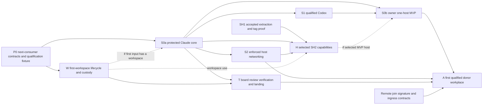

# Swarma implementation plan

Status: integrated review draft, 2026-10-13. Assembler: core astra. This plan orders future implementation, qualification and activation; it records no completed runtime qualification and authorizes no deployment or credential use. The eight lens drafts are supporting evidence. The risk section is initially assembled from their stopping conditions and awaits the lens-8 draft. Opus owns the Russian translation after integrated review.

## 1. Goal and delivery boundary

Build the final protected launch boundary first, prove its refusal and recovery behavior, then add the consumers that make it useful. Keep today's task-board runtime working while extracting its session module independently. Admit the first external worker only after the complete local MVP, enforced host boundaries and code-delivery path qualify together.

Three results must be reported separately:

- **SH1** preserves the accepted task-board/session behavior across a module extraction. It establishes no new isolation or authority.
- **S0a** proves one protected local Claude launch across operator, broker, dispatcher, helper and agent accounts, including the complete small-slice recovery contract.
- **S0b** is the owner's larger one-host MVP: **Claude and qualified Codex**, separate keeper/broker/worker identities, an actual composed-plan caller/host seam, a durable exact-byte signed mailbox, explicit human enrollment and a task through the OS-user chain. It needs neither a board nor a remote harness. A passing Claude checkpoint is not this MVP.

The first external-admission milestone **A** additionally needs enforced networking, the complete transfer/review/verification/landing path and the selected donor/workplace tuple. Neither S0a nor S0b supplies that permission. The labels below are planning milestones, not new protocol versions or a renumbering of CB7's release slices. Historical CIP `F25` is distinct from review finding F-25.

The plan preserves the accepted F-1…F-28 baseline, including F-26's withdrawal, and all 44 confirmed cycle-3 findings. Optional policies within findings remain choices. Implementation is outside this review's scope.

## 2. Principles that prevent rework

1. **Use the final boundary from the first slice.** One dispatcher socket service, one launcher/library and the existing root-helper path; no interim command-mode dispatcher, launch tickets, board privileged receiver or second executor.
2. **Freeze the next actual consumer, including failure.** Agree producer/consumer bytes, authority, observation, retention and recovery before implementing that interface. Independent fixtures and SH1 source work can proceed without freezing every future remote format.
3. **Keep five evidence facts distinct:** decided semantics, published draft, frozen producer/consumer contract, released implementation/feature availability, and qualified activation on a named host/runtime tuple. These are not new runtime states. A JSON schema, source review, released binary or green generic CI job does not establish the next fact.
4. **Attach each gate to first use.** A local workspace needs cleanup before its first launch; an early mailbox needs its actual storage and delivery guarantees then. Milestone names cannot postpone consumed obligations.
5. **Retain evidence through failure.** Unknown effects do not become absent, a successful stop does not erase export obligations, and binary rollback does not restore old authority over later records.
6. **Minimize the first supported set.** One trusted caller class, one initial provider tuple, one narrow qualified invocation, one inert review path, one selected transport performer and one donor backend. Generalize after the complete loop supplies evidence.
7. **Separate engineering concurrency from release order.** S1 and S2 engineering may overlap after shared freezes; changing CB7's adopted Claude → Codex → enforced-network release order needs explicit disposition.
8. **Measure accepted changes.** Include review, rework, qualification, retained resources and operator attention. Twenty-four review seats do not imply twenty-four useful implementation producers.

## 3. Milestones, critical path and parallel work

**W** is the complete local workspace lifecycle: materialize, work, stop/fence, distinct exporter execution, refusal/cleanup authority and durable complete-content custody. **T** adds board import, candidate review, off-host verification and landing. W is a first-use gate, not a requirement to finish every T consumer before launching anything.

**Notation:** milestone H means hosted-session activation. In verification bindings B/C/H, H means the independently approved verification harness revision (recipe-bundle digest or protected-trunk OID). Selecting verification H never creates a hosted-session dependency for T.

The graph shows technical dependencies. It does not authorize early S2 release or remove S1 from the owner's MVP. Generic H remains board-optional even with a workspace; full T is required for its chosen board-delivery integration and for A. H needs stable extracted-module/tag proof, but disposable H qualification need not wait for production SH1 cut-over.

| Milestone | Scope and accountable lanes | Dependencies | Completion evidence | Initial estimate |
|---|---|---|---|---|
| **P0** | Broker, dispatcher, helper, launcher and operator owners publish the consumed contracts; infrastructure supplies the real boundary fixture; docs owners align guidance. | Final input pins, named producer/consumer owners, disposition of choices needed by the first consumer. | Shared canonical/negative/mutation vectors, closed error/outcome grammar, actual account/socket/descriptor fixture and explicit live-lab prerequisite. | M–L; first calibration point. |
| **S0a** | Installed operator/observer, broker file store and software root, dispatcher service, helper/launcher v0 and approved agent-side Claude executor. | P0; supported provider tuple; authorized live-lab evidence; static denial before account creation; published first-input and env-lifetime choices. W is included if the input has a workspace. | Complete CB7 slice-0 positive, refusal, crash, observation, restore, time, rebind, cold-reboot and ALLSTOP evidence. Only the agent executor receives the lease. | L; integration-heavy despite one provider. |
| **S1** | Broker auth owner, private app-server external-token holder and supported Codex harness tuple. | S0a; C4 disposition; published writer containment, attempt/vendor-store outcome and cleanup contracts; both-platform lab/account plan. | Real supported-release login, policy, renewal/failure and every CB7 §9.6 replacement/rotation case on both required platforms. | L; provider behavior is an open schedule risk. |
| **S0b** | Keeper/identity, signed mailbox, actual composed-plan caller/host and provider owners complete the one-host chain. | S0a + S1; generation-bound registration and signed-intent/recovery contracts; selected seam. H/S2 apply if the seam actually uses H. | Durable authenticated task/result across the named OS users using Claude and Codex; wrong signer/scope/generation/expiry and changed intent under an existing ID refuse. | L; depends on the minimum seam selected. |
| **S2** | Helper v1, network/proxy and infrastructure owners implement account/service enforcement, resolver separation, watcher freeze and usage continuity. | Core recovery; frozen R-NETBIND, served-policy/listener/service-generation and host-matrix contracts. Provider-specific rows need that provider's evidence. | Actual kernel and served-policy agreement; bypass/precedence/session/replacement/clock vectors; mandatory hard minima and any explicitly allowed per-host soft-row disposition. | L per supported boundary set; no OS parity by assertion. |
| **W** | Dispatcher/helper/launcher/transfer own the first workspace and retained result. Board agrees on shared B/manifest/result representations. | Frozen core effect/intake contracts and applicable qualified profile/host; no automatic dependency on completed S0a or full T. | Exact B; account-wide absence; bounded cleanup authority; distinct execution receipts; verified result and every blob outside the deletion domain; refusal/unknown retention and authenticated release. | L shared with T; move the necessary subset into the first workspace-bearing slice. |
| **T** | Board owns deterministic import, candidate lineage and verdicts; infrastructure owns candidate jobs and selected non-agent external-effect performer. | Core + W; inert review, approved H recipe, runner and repository/artifact transport contracts. | Complete materialize-to-land scenario, cumulative rework obligations, offline candidate execution, current exact-C result consumption and signed non-forced landing at the effect boundary. | L; several owners and one complete acceptance chain. |
| **A** | Remote join/bridge/registry/donor-A, workplace executor/helper, trust, board and infrastructure owners. | S0b + S2 + T; selected host/donor/harness tuple; join/key-suite/ingress contracts and explicit admission; R-SHARED placement. | Join → first job → disconnect/reconnect → export/rework → final export/retirement, with donor stop and project workplace stop separately proved. | L; first external-admission gate. |
| **H** | Session host owns durable control/delivery; agent runner owns PTY/app-server/leases; dispatcher owns physical start/stop. Board is optional. | Stable accepted module/tag; core and supported provider; SH7:136 authenticated state APIs plus agent runners at service-UID move; hard SH7:140 v1 service/parent-anchor/resolver readiness; W if workspace-bearing. | Current-epoch lifecycle, absence/native-lock, receipt/unknown delivery, retained-output/control reserve and ordinary cumulative restart-budget cases; optional consumers qualify separately. | L–XL; source estimate 45–100 clean or 150–300 rework landing-hours. |

M means a bounded contract/consumer integration; L spans several process/repository boundaries and recovery; XL adds durable service lifecycle and multiple consumers. These are relative estimates, not calendar promises. SH2 hours are historical source-plan estimates. No fresh hour, token or vendor-price measurement was produced here. Re-estimate after the first P0/S0a fixture and SH1 F proof, including queues, access, review and rework.

The likely critical path is the longest of core/MVP/provider qualification, host enforcement, and complete transfer/verification, followed by workplace integration. Resolve first intake, actual MVP host, exporter custody and remote ingress early because each affects multiple consumers. Prepare SH1, frozen vectors, inert board review, disposable Linux/macOS fixtures and provider research in parallel. Keep source-copy G and X work parallel only after their accepted seams are disjoint and frozen. Documentation follows each owning contract wave; it is not a global book-completion barrier.

## 4. Contract publication order

Each consumed packet names both owners, source revision, exact domains/canonical bytes and framing, actor/generation, idempotency key versus complete intent, closed outcomes, time/cancellation, durable retention/restore, vectors and disabled capabilities. Use one owner-linked typed index in the existing registers. Distinguish normative rules, historical audit IDs, signed domains, body discriminators, transport/schema labels and provisional names; resolve ambiguity before golden bytes without blanket renaming or a second schema service.

| Freeze | Before which consumer | Decisions that must be concrete |
|---|---|---|
| Core authority and recovery | P0/S0a | `grant/1`, `revocation/1`, `broker/1`, `dispatch/1`; caller signatures; operator command/custody/replay; effect/observation/retention floors; R-GEN/R-TIME/R-REBIND/R-LOCK; whole-act ALLSTOP and never-launched absence. |
| Plan and privileged intake | First launch | Selected opaque exact bytes or closed plan schema/digest; approved invocation; one bounded immutable FD3 lifecycle; final-source binding; machine-owned exec-policy selector/body pin; actual interpreted-input closure; env lease cleanup disposition. |
| Keeper and signed mailbox | S0b | Registration tuple and recorded one-shot status, active-ledger/detach/revocation; own-key signing and admitted key classes; full-intent conflicts at `(principal,id)`; delivery/retention/storage. Broker-root migration is separately specified if used. |
| Provider and live lab | Real S0a/S1 qualification | Selected runtime/channel and all-writer/outcome recovery; positively admitted platform/vendor artifacts; enrollment/account ownership, custody, containment, redacted export and teardown; required explicit lab authorization. |
| Network and shared guard | S2 and T's N16 use | Policy/lock/listener/service identities and served digest; kernel/proxy lifecycle; complete guard ranges; exact CONNECT claim; usage-window continuity; resolver/socket matrix; watcher ordering/release/version and notification scope. |
| Local workspace custody | W | Canonical mode/type/content manifest for immutable B, archive relation, plan scope, distinct physical executions, bounded cleanup consent/capacity, security holds, complete-content durability, authenticated retrieval/release and refusal/repair. |
| Candidate delivery | T | Independent board-B recomputation, import/C identity, integration review baseline and cumulative flags, inert review/verdict; N16 fetch/offline split; B/C/H-bound job/result; selected effect performer and each effect's checks. |
| Remote work | A; B separately | Join/package/first-contact mode, signature suite, channel/backend wire owner, durable claims/observations; ingress creation and relay/job/export/reconnect lifetime. B gets its own provisioner and inference/refresh/local-control principals. |
| Hosted capabilities | First H or earlier actual consumer | Current lifecycle consent, session permit and per-start claims; authenticated runner/current epoch, fate, delivery evidence, storage/control reserve. Reboot requester, board adapter, delegation, goals and other optional routes freeze only before use. |

LR6 currently requires a workspace section. Prefer a jointly published narrow non-workspace S0a proof only if launcher/dispatcher/helper/broker owners can specify it without guessed nulls or bypassed checks. Otherwise include W in S0a acceptance. Complete T is not S0a's predecessor. The same distinction keeps generic workspace-bearing H board-optional.

Select the actual FD3/invocation and env cleanup mechanisms before coding their consumers. Successful env exec leaves no surviving broker client; disconnect, process exit or a fictional later callback cannot stand in for the chosen release/retained-record contract. Initial authenticated dispatcher-to-root-helper sudo/role admission does not require helper-v2 signed grants; there is no caller-to-dispatcher sudo route. Optional service-metadata export may stay disabled; that never waives a workspace obligation.

## 5. Security and acceptance at first use

### Protected launch and the local MVP

S0a carries all CB7 small-slice obligations: mandatory class refusal, canonical verification, current time/revocation, bind/unbind and retained observations, rebind, outcome/absence, restore fencing, lock ordering and journaled ALLSTOP with explicit recovery. Qualify protected exec-profile selection and the whole admitted invocation before the first start. An approved interpreter path does not permit worker-supplied code/config/plugins/imports to execute locally; that execution belongs in R-VERIFY.

R-STANDING's admitted plan-owned surface digests apply before the first standing launch, restart or resume, whenever that consumer is enabled. A later-opened candidate tree is not a plan-owned surface and takes its separate inert-review gate.

Keep key custody distinct: broker software root/server-side authority under `swarma-operator`; hardware-backed device private key on the phone; generation-bound dispatcher caller key with the caller; keeper-derived identity keys under their own contract. The interactive human account is not a platform key store. Operator acts refuse agent-session origin; widening authenticates and confirms exact content, while narrowing authenticates. R-ALLSTOP uses authentication plus one node-wide confirmation on the phone path, or the published password-authenticated terminal fallback; no extra confirmation is imposed on ordinary narrowing or already-admitted service acts. Observer access reads only its published non-secret surface. Ordinary already-authorized cleanup remains ordinary service work, not a new manual operator ceremony.

Install static range denial before account creation, with install/service-start/scheduled precedence probes. The v0 range rule permits the declared platform proxy listeners; it does not prove no outbound socket or v1 own-port isolation. Unix-socket reachability is separately qualified. Apply each class's actual published minima: the first trusted class uses its v0 baseline and qualified declared rows; the untrusted class requires hard process-count, enforced egress, exec and temporary isolation. Memory/CPU/disk follow actual matrix availability and explicit allowed per-host soft acceptance through either protected operator path. An OS name alone admits or excludes nothing.

ALLSTOP sends independent cuts/stops while dispatcher or broker is unavailable, but completion/reopening requires all durable service parts, including dispatcher reconciliation. Fence create/start/ingress before claiming final absence. A never-launched generation requires fresh authoritative no-launch coverage plus fenced absence, not a dummy start, absent receipt inference or generic UID kill. Do not write another service's offline state.

S0b adds the actual keeper/mailbox/seam after S1. Preserve full signed bytes and compare full canonical intent under the existing `(principal,id)` key; changed intent conflicts rather than creating a new digest-keyed request. Peer data never acquires operator authority. Delivery reconciliation has three branches: positive application evidence resolves applied without redelivery; intact confirmed non-application permits only the published eligible ordinary-input retry; unresolved evidence stays unknown/fenced, and unknown approval/control effects never auto-replay. SH2 uses its qualified transcript evidence; a different early mailbox seam must publish its own equivalent evidence, not assume that implementation. Generic delegated host actions remain closed until a constructible registered-action route is published. Any early durable mailbox/host output consumes its budgets, evidence reserve and recovery contract immediately.

### Workspace, review, verification and landing

Use three distinct retirement barriers. Confirmed account-wide absence may release execution capacity. Verified durable result **and every referenced blob** outside the deletion domain may permit home/UID retirement before board import. Retained content is released only by authenticated import acknowledgement or another authorized disposition. A digest, pointer or metadata-only receipt alone proves none of complete-content custody.

W publishes cleanup-only authority tied to the original admission, exact generation/round/exporter/base/scope and bounded capacity, including ordinary work expiry. It grants no worker repair or inherited R-SESSION authority. Revocation, compromise, restore, maintenance and ALLSTOP retain their explicit gates. Materialize, work, exporter and any repair have distinct linked physical claims/receipts/absence evidence. Unknown/refused export retains required allocation/home/UID obligations even after execution capacity releases. Bounded repair needs current work authority and new effects; unchanged deterministic refusal can continue pinning resources until an authorized disposition. Standing discard is an unselected owner option. Qualify worker-entry permission refusal separately from infrastructure failure; no root-read/chmod bypass.

W checks archive correspondence with B's manifest before work; T independently recomputes the complete mode/type/content manifest from repository B at import. Board imports with independent Git administration and hooks/filters/drivers disabled, yielding exact C. Review flags derive from the trusted integration baseline, distinct from materialization B and verification H. Rework from C1 to C2 re-admits its immutable base and recomputes inherited sensitive/provenance obligations; acknowledgements and verdicts bind to C2, including equal-tree/different-commit cases.

Start review with exact-C diffs/blobs outside discovery roots. Entering a candidate tree requires a qualified strict context adapter covering startup, nested reads, reload, resume and child entry. Candidate acceptance does not admit its instructions/hooks/MCP/skills as control. Inert presentation does not eliminate prompt-injection risk; reviewer eligibility and effect-boundary checks remain necessary.

N16 fetches dependencies through a bounded inert path with no candidate hooks/code/plugins/install scripts. Only after fetch ends does candidate build/test execute without external network, resolver or inherited egress-service socket; runner-local loopback may remain. Missing dependencies fail offline. Approved H supplies driver/recipe outside C; writable candidate artifacts/caches cannot contaminate control or another job. No local agent-account or operator-host fallback.

Bind job and result to C OID/tree, B, H, artifact, recipe, image and limits. A late J1 pass **or failure** after C2 selection updates J1 history only; it neither satisfies nor regresses C2. Check current candidate/request at the state transition. Preserve duplicates/crash outcomes; the draft's one bounded infrastructure retry never turns genuine test failure into a pass.

Select an existing, off-host or explicitly operator-mediated **non-agent performer** for pending publication, artifact handoff, base refresh and landing. Specify its invocation, credential/signing custody, route and result. Each effect checks its own prerequisites at the performer: pending publication validates import and a namespace already qualified as CI-free on the actual repository host across all workflow triggers. Keep the workflow-filter invariant pinned; a local name, branch fallback or publish-then-observe is not qualification. Landing additionally rechecks current exact-C verdict, required acknowledgements, verification and protected trunk. Preserve signed non-forced fast-forward; moved trunk needs the published fresh candidate/review/verification path. No mandatory new daemon or local service row follows unless the chosen topology needs it. Private/tailnet runner ingress is not an ordinary N15 allowlist addition.

### Enforced networking and the first donor

S2 qualifies kernel enforcement together with actual served proxy policy, account/service generation, resolver/socket paths and existing sessions. Restore the complete dial-guard exclusions. CONNECT confines tunnel authority/address, not an unobserved inner application origin or provider-side web action; no TLS interception is added. Usage belongs to identity/window across listener replacement, reapply, rebind and service crash. Unknown usage closes budget-consuming activity unless a conservative bound/reservation establishes remaining allowance, including replacement within the same window. Uncertain time never creates fresh allowance. Preserve the published window semantics without prescribing rolling-24-hour accounting or per-byte fsync; configured caps alone are not usage evidence.

Publish v0 watcher stop/hold/status honestly. Full per-account freeze is v1: newer narrowing dominates stale reapply, closes affected streams, and survives required recovery. Release is authorized widening, separate from restart and independent security holds. Stop never waits for network or alert acknowledgement. An alert route needs an owner, bounded typed delivery/storage and unavailable-channel behavior; an explicit status-only stage is valid and promises no phone delivery.

A admits one selected untrusted workplace tuple: hard required minima, zero egress including loopback, no host lease/binding, no local harness loop and only the declared platform socket set. R-SHARED excludes shared **non-platform** services beside untrusted work. Trusted-circle membership alone supplies no reviewer/host-loop permission or relaxed workplace boundary; preserve separately admitted class/role/placement predicates and the canonical donor-opt-in limit.

Freeze ingress, relay, job/start, export, reconnect and stop as one physical lifetime. Incoming SSH and in-flight authentication can recreate UID processes despite egress denial; close generation-bound creation before quiet absence and keep the fence through export. Permanent certificate/channel retirement is distinct from a reusable round transition. A standing runner alone does not solve relay quiescence.

Join-to-result qualification includes invitation/challenge/package ordering, atomic same-key enrollment retry, admitted P-256 worker suite and unchanged final-envelope verification. First contact always verifies WebPKI; the selected local-DNSSEC mode verifies its evidence and invitation pins when present. Only a predeclared environment without DNSSEC selects the invitation-pin branch before lookup, then validates mandatory pins and WebPKI. Failure never downgrades between modes. The machine owner runs donor init; project services store no donor provider credentials. A requires a separate public join-entry host/ingress owner and cost; it holds no admission-signing key, and CA custody stays outside workplace/relay. Variant A's donor-side lack of isolation remains explicit. B's provisioner/principal repairs and C's later rollout do not delay unrelated A consumers.

## 6. SH1 extraction and the SH2 boundary

Preserve today's board composition: task/run completion, routing, goal ledger, CR/repository landing and the `tb-sessiond` wrapper remain board responsibilities. Do not add SH2 authority, new goal authorship or new durability claims during a copy. The arbiter-approved source freeze defines the exact provider/transport/native-goal/command/hosted matrix. Newer observed Muse registration is a source delta to account for, not proof of C7 or target hosted qualification.

| Gate | Required result | Ordering and owner |
|---|---|---|
| **F** | Representative proof of the actual final dependency graph; unchanged-test inventories/hashes, real converter/guard mutations and explicit baseline failures. | Extraction owner and reviewer before seam freeze. Prototype consumer build/vet, pseudo-version/file proxy and uninstrumented guard reads are insufficient. |
| **O** | Immutable accepted source snapshot with provenance/NOTICE and explicit provider/runtime inventory; provenance/leak review before the first public source push. | Source/board owners; no history migration required. Reconcile accepted upstream changes before copy. |
| **G / X → Y** | Disjoint neutral seams and copied module changes, then converged integration preserving ownership and behavior. | Parallel only after interfaces freeze; no competing edits or new board server. |
| **Z** | Immutable tag plus three distinct lanes: unchanged private projection, whole-board immutable-tag consumer, and module conformance. | Hosted macOS/Linux and private-source policies; no credential or raw private artifact leakage. |
| **C1** | Paired live board/module cut-over with all entries quiesced, one state writer, semantic old/new compatibility and safe rollback. | Operator maintenance window **no earlier than 2026-10-19**; calendar floor is not a booked date. |

SH1's historical estimate is 18–24 clean or 60–72 rework serial landing-hours, including landing. Re-estimate after F; neither 24 seats nor a prototype CI duration is a throughput multiplier. Maintain current work until C1.

After O, freeze the old source and name one forward-port integrator. Every accepted in-flight port records source commit, destination commit and validation identity; active reviews finish on their original base. Regenerate the baseline and rerun affected evidence after each accepted port. Do not author two evolving runtimes in parallel.

C1 closes wrapper auto-start, guarded automatic protocol-upgrade, scheduled/recovery/operator paths and board runners. Tag publication or hosted consumer CI does not authorize installing a wrapper that replaces the live daemon early. Qualify all four old/new wrapper/daemon pairings semantically, not just successful attachment. Preserve exact goal acknowledgement, pending-binding refusal, board-driven completion and replay repair from the durable terminal event; unavailable declared goal context must refuse before effects instead of silently becoming goal-free.

Use the current host's authorized maintenance controls for SH1. The common stop/swap/compatibility pattern does not make future `swarma-operator`, dispatcher/helper, R-SESSION or ALLSTOP implementation a new C1 prerequisite. Current daemon-owned Claude PTYs end when it is replaced; do not promise transparent SH2 survival. Preserve all later accepted records during rollback; an older snapshot is not a migration shortcut.

H is a separate gated implementation. Stable module/tag evidence precedes activation; disposable H can qualify before live C1. At service-UID migration, replace direct notice/context file access with authenticated APIs and introduce agent-account runners together. A goal-free lab uses isolated target state, not broadened permissions to live board files. Verified v1 host service deny-all, parent anchor and resolver evidence are mandatory even without goals. W precedes workspace use; full T is needed only for the chosen board-delivery integration and A.

Qualify dispatcher-owned stop, fresh-runner native-lock and current surface/identity checks separately. Ordinary successors retain cumulative or first-start-anchored restart budgets and allocation lifetime across controller/execution replacement and provider interruption; exhaustion refuses another successor. Standing sessions keep their separate no-runtime-limit rule and current successor authorization. D-RESUME preserves the settled same-machine non-breaking semver path without an extra version-change qualification row; report `resume-failed` without automatic fallback. Caller/board own goals; optional self-goals and automatic reboot requester remain separately gated.

## 7. Qualification environments and evidence

Keep four trust cases explicit:

| Lane | Permitted proof | Boundary |
|---|---|---|
| SH1 hosted projection/consumer/module CI | Trusted pinned extraction and private whole-board/tag compatibility. | Existing private-checkout and artifact policies apply; prototype evidence does not prove release or platform isolation. |
| Disposable privileged platform qualification | Real root/service/agent transitions and actual OS enforcement; hosted macOS and disposable Linux are candidates. | Privilege belongs to the disposable test environment. An unavailable backend is unsupported, not a pass for the requested OS label. |
| Ephemeral candidate verification | Off-host secret-free untrusted-C execution under N16, using a qualified VM or other demonstrated isolation boundary. | Separate pool control, other jobs, writable caches and durable state. OVH Linux is a placement candidate, not completed qualification. |
| Separately authorized live-provider lab | Real S0a lease/injection and S1 login/rotation evidence for positively admitted platform/vendor artifacts. | Publish account ownership, ceremony, custody, network/containment, redaction and teardown plus any necessary exception to the general secret-free test rule before execution. |

Candidate code/tests stay secret-free even after exact-C acceptance. Accepted bytes alone supply no live-lab authorization. Historical row-specific login exceptions and provider observations are scoped evidence, not standing permission or current supported-release passes. CB7 excludes one vendor account across machines without a separate ownership design, including sequential ceremonies. Distinct dedicated test accounts per independent host owner are the smallest initial proposal; any reuse first resolves prior writer and ambiguous rotation/store outcomes. Missing lab authority blocks dependent live acceptance while synthetic and contract work proceeds.

Every activation packet binds contract/implementation/tool pins, exact host OS/kernel/backend/image, harness/entrypoint and policy digests, relevant principal/generation/epoch/effect, and B/C/H/artifact identities. Include positive controls, precise negatives, crash cuts, observed outcomes and retained obligations. Independent review states exactly what was exercised. Skipped, stale, unsupported, partial or unknown evidence never passes. A security mutant must reach its intended assertion with a passing baseline; compile failure or an unrelated red is not a kill.

The common corpus covers before-intent, intent-before-effect, effect-in-progress, persisted-result/lost-ack and recovery crashes; original IDs/arguments stay fixed. Include UID reuse, old callbacks, final-material-release fences, changed signed intent, time/suspend/reboot, writer disappearance versus vendor outcome, restore, and both ALLSTOP findings. Observation does not create work. Lock revalidation follows slow external I/O; no state lock spans a synchronous cross-service call.

Network negatives need live positive endpoint/protocol controls and correct actor attribution, distinguishing a policy refusal from a dead listener/DNS/provider. Prove existing traffic before testing narrowing. Exercise actual resolver paths, established proxy streams, another unaffected identity and service replacement. Never disable containment on an admitted production host to manufacture a control. Record periodic detection bounds without calling them continuous verification.

Requalify affected rows when their contract, code, runtime tuple or enforcement inputs change. Reuse authoring/tooling, not unrelated qualification claims. No builds, tests, credential enrollment or active probes were performed by this planning collective.

## 8. Operations, maintenance and recovery

Prefer disposable Linux for the first integrated control/recovery fixture, with hosted macOS evidence in parallel. Choose deployment by complete measured capability, not OS reputation. Keep the overloaded operator mini on its working runtime until the replacement qualifies and the operator schedules its actual maintenance window. Heavy qualification and candidate execution remain off-host.

Expose protected observer/recovery control before new-work readiness. Status distinguishes admission from control availability, restore from ALLSTOP, unknown effects/writers from completed outcomes, and the specific reconciliation needed. Missing dispatcher never enables a local privileged fallback. Record-local uncertainty may fence that record; shared accounting uncertainty closes node admission.

At every service start and on the installer's published root-controlled bounded schedule, verify applicable service rows, range denial and active precedence, parent anchors/kernel states, listener/served-policy generation and resolver restrictions. Missing, mismatched or unreadable evidence drops affected enforced readiness and holds new authority; report and recover through the published R-MAINT/R-FATE response without an implicit unit-wide execution kill. Publish the entry point, interval and response ordering before activation and record its detection window; disposable lab proof is not continuing target readiness or continuous enforcement.

For **platform** maintenance: prepare pinned old/new artifacts and reader/writer compatibility, affected-set/process-fate and obligation inventory; obtain and durably record the current authorized operator act before its mutating closure; close every applicable admission/create/launch/ingress entry; stop and reconcile all required owners; swap only with complete evidence; recover control and check current authority/time/restore/ALLSTOP/network; reopen authorized entries last. Read-only preparation precedes the act. Unknown results hold the window. Ordinary service cleanup retains its admitted authority. SH1 uses the existing-runtime counterpart described in §6; a combined migration explicitly satisfies both sets of gates.

| Event | Required disposition |
|---|---|
| New version fails after retaining new records | Roll back only if the old reader **and writer** preserve every retained later record/schema/obligation. Otherwise keep admission closed and repair forward; never overlay an old snapshot. |
| Restore exposes old authority | Fence before restored bytes become visible and close all direct readers/autostarts. Keep restore mark and complete freshness evidence outside the rollback domain. Recover acknowledged history **or** explicitly invalidate every old configured broker-authorization root and issue fresh broker authority. This does not replace D-IDENTITY standing keys or SSH CAs; companion ledger/time/effect/vendor outcomes still reconcile independently. |
| Restore and ALLSTOP coexist | Clear each through its own complete authorized recovery. Restart, watcher release or one cleared fence does not clear the other. |
| Cold reboot | Re-establish static-deny precedence and trusted time before admission/material, reconcile supervisor executions to lost/absence as specified, and retain stopped standing allocations without automatic fresh starts. |
| Credential-owner replacement | Prove old writer/descendant absence and independently reconcile vendor rotation/store outcome. A dead PID alone permits no refresh retry. |
| Export/verification overlaps maintenance | Preserve every result/blob/candidate/job identity and pending obligation. Late job replies update their own history, not the current candidate. Retention and control reserves survive replacement. |

Ordinary backups remain allowed; actual restore entry points must invoke the fenced procedure. A witness restored with the same machine proves no freshness, and a local timestamp cannot detect arbitrary whole-host rollback. Preserve explicit recovery limits rather than claiming immunity to arbitrary disk loss.

Keep provider windows, authority horizons, account lifetime and physical execution lifetime separate. Ordinary defaults are 24-hour allocation/7-day maximum and 4-hour execution/12-hour maximum; standing runtime has its own no-limit rule. Provider reset extends none of them. Rebind changes its named credential binding, not successor consent, watcher hold or ALLSTOP. Expiry still follows qualified stop/cleanup; unknown/refused export keeps its obligation.

Proposed H pacing policy: publish a supported harness's positive current-execution/current-epoch provider-throttle classification, bounded retry suppression and closed delivery. Unknown/authentication/transport failures use their own recovery; unclassified output and stale reset hints do not change current readiness. Reset is only eligibility to reconsider a retry, never automatic wake from explicit park/security hold or evidence that delivery did not apply. Use the existing authorized path until the reason-specific policy qualifies. Prove no duplicate platform delivery or unbounded successor churn; do not promise prevention of every vendor context resend.

## 9. Workforce, cost and forecasting

Use one producer for each bounded change, an independent eligible reviewer, a qualification owner and available landing capacity. Open another lane only when those resources and frozen interfaces exist. Preserve existing board/project selection policy and record requested/resolved model, effort, harness and service tier. Current owner posture is subscription-first and model-agnostic orchestration, with Opus 5.5 orchestrator, Sonnet 5.5 workers and Luna Max allowed as worker, not orchestrator. Codex uses standard service; fast mode was removed. This is an owner policy record, not a vendor comparison.

Routine bounded work can use the admitted worker baseline. For privileged launch, credentials, parsers, fences, recovery and integrity, propose a strong admitted producer, deep review and a second independent adversarial check. General Opus deciding-reviewer use is a recommendation extending a task-specific archive-secrets decision, not a universal adopted requirement. Existing exact-C review eligibility and producer/reviewer separation still apply. Optional local-only reviewer/requester exclusion remains an owner choice. Muse can provide independent review/research when available and admitted; registry presence and its prioritized but unqualified subscription channel are not committed production capacity. Opus translates the final operator-facing plan.

Calibrate a **whole accepted-change series**, not one successful run. Record trusted-side context preparation and input-pack gathering/refresh, producer, review, rework, qualification interpretation and close-out tokens by actual provider/account/model; separate cached/input/output units without double counting. Keep subscription-window observations distinct from token totals and money. Add runner/queue time, retention/transfer, live-lab ceremony/custody/teardown and operator acts. Two machines observing a shared provider window are not two allowances.

Initial pilot reserve: one bounded producer plus its required review pair, qualification and one complete rework cycle. Repeat on the next two comparable changes and report the observed range/max, not an invented percentile. Then assign per-slice provider-separated envelopes:

`slice envelope = context preparation + producer + review + reserved rework + qualification interpretation + close-out`

Numeric budgets remain **unmeasured** until that pilot. Reforecast after a contract reopens, runtime changes or extra vectors appear. A second full rework cycle triggers scope reduction or the ordinary task-owner budget extension. Include cleanup/retention before first workspace admission, even when W is inside S0a/S0b, and count the separate join-entry host once before predicting donor capacity.

Planning envelopes are not exact spend cutoffs. Delivered credentials and vendor-accepted work cannot be recalled by a local lease freeze; opaque CONNECT byte/request caps are not token meters. Use existing scheduling and authorized stop/freeze paths; add no quota daemon, unsupported broker concurrency predicate or standing lifetime cap. Keep donor provider allowance separate, while still charging project materialize/export/storage/review/runner/operator costs. Project retirement proves neither donor stop nor vendor credential revocation.

Reserve review/rework capacity before another producer. On provider refusal, preserve identity/context/effects and follow the qualified recovery path; changing provider is a deliberate new admitted run with explicit handoff. Never weaken qualification to spend remaining quota. Measure legitimate materialization/light-check behavior against watcher thresholds and include false-positive release/recovery operator cost; measurements alone do not widen a threshold. The current quorum's use-until-refusal instruction is specific to this review, not permanent implementation policy.

## 10. Risks and stopping criteria

This initial register consolidates the published lenses; lens 8 will review and extend it. A missing publication/authorization, unavailable evidence or exhausted capacity holds the affected activation while independent work continues. A demonstrated counterexample to the selected mechanism triggers redesign of that mechanism. Neither a guessed timer nor an ordinary qualification delay justifies global shutdown or redesign. Preserve evidence and obligations; never replace a failed gate with weaker authority or a hidden fallback.

| Risk | Early signal | Stop or redesign criterion | Recovery owner |
|---|---|---|---|
| Contracts change while both ends are built | Conflicting canonical vectors, unknown wire owner, unresolved first consumer or outcome. | Stop dependent implementation/activation; narrow the consumer and publish one joint packet. | Producer/consumer contract owners. |
| First slice grows into the whole platform | S0a requires remote schemas or full T; board-free H/MVP gains an implicit board dependency. | Restore the W/full-T and optional-consumer cuts without waiving actual cleanup or host gates. | Architecture plus affected module owners. |
| A happy-path demo is reported as readiness | Missing positive controls, recovery cuts, exact target tuple or both-platform provider rows. | Do not mark the slice complete or admit its dependents. | Qualification reviewer and deployment owner. |
| Provider lifetime or lab remains unconstructible | Ambiguous refresh outcome, overlapping writer, unsupported release, missing authorized lab/account boundary. | Hold live S0a/S1 acceptance and preserve synthetic work. Resolve evidence/authorization first; redesign only if a demonstrated counterexample defeats the selected channel's invariant. | Broker/provider and lab owners. |
| Enforcement cannot prove required minima | Soft/unknown mandatory row, wrong listener generation, bypass or policy/readiness drift. | Refuse the affected class/host; choose another qualified tuple or explicit permitted policy disposition. | Helper/network/infrastructure. |
| Cleanup or output consumes control capacity | Refused rounds accumulate, blobs lack independent custody, per-producer debt resets, control reserve unproved. | Close new affected admission and retain obligations. Use current repair/waiver authority where applicable; redesign only when evidence shows the chosen bounds/custody mechanism cannot preserve required control and retention. | Dispatcher/transfer/host plus operator. |
| Candidate becomes control or executes with network | Discovery loads hooks, fetch executes a script, job shares control cache, result is unbound. | Stop that review/runner lane; use inert review or repair isolated execution; no local fallback. | Board/harness/runner owners. |
| Ingress recreates a supposedly absent workplace | Relay/sshd or in-flight auth crosses start/export/stop fence. | Hold A and redesign the joint ingress/job lifetime; no process-name exceptions. | Bridge/helper/dispatcher. |
| Recovery discards later truth | Restored witness shares rollback domain; missing service ALLSTOP part; old writer cannot preserve new records. | Remain fenced, reconcile or invalidate/reissue authority, or fix forward. | State owners and operator. |
| SH1 changes behavior or interrupts daily work early | Final graph/guard proof missing, accepted source delta lost, wrapper auto-upgrades before C1. | Stop extraction release/cut-over, restore accepted-source parity and close all entry paths. | Extraction/board owners. |
| Agent concurrency exceeds accepted throughput | Review/runner queue grows, repeated rework, provider window lacks repair reserve. | Stop new producers, split scopes/reforecast; do not lower review or repeat speculative launches. | Orchestrator and qualification owner. |
| Operator work is underbudgeted | Frequent waivers, false alerts, repeated enrollment/recovery or no protected observer path. | Keep A at one worker/task class and measure; redesign workflow without blanket confirmation or automatic waiver. | Operations and operator. |

No fixed calendar or cost kill threshold is fabricated. Set measurable pilot bounds with the actual owners after the first traces; required invariant failure is already a release hold.

## 11. What we deliberately do not build now

- A second dispatcher/privileged executor, launch tickets, a command-mode fallback, interim board receiver, universal plugin bus or new goal ledger.
- A universal wire/schema service, quota/billing service, broad donor verbs in user manager, or helper-v2 signature verification before its actual consumer.
- A same-UID Codex refresh workaround, automatic alternate login, seamless env credential handoff without a qualified holder, or provider activation from historical evidence.
- Full candidate-tree context adapters before inert exact-C review proves insufficient; candidate control surfaces remain unadmitted after code acceptance.
- Generic delegated keeper actions, agent-authored self-goals or a board-free agent-completion API. Existing caller/board goal/status/completion compatibility stays required.
- Optional web tooling, donor B/C deployment, Windows, arbitrary languages/backends or full recursive bootstrap before their selected consumers and qualification exist.
- Total topology secrecy, application-origin control inside opaque CONNECT, exact provider-spend cutoff, transparent SH1 PTY survival or unconditional reclamation of refused exports.
- A new transport daemon merely because external effects need a named non-agent performer; choose and qualify the actual topology first.

## 12. Decisions and publication choices still needed

Ordinary byte/mechanism selection belongs to the joint module owners unless the source reserves a policy decision for the human owner. The plan does not turn all implementation choices into approval requests.

| Choice | Who resolves it | Latest safe point and bounded default |
|---|---|---|
| First intake and minimum composed-plan/mailbox seam | Launcher/dispatcher/helper/broker and actual consumer owners. | P0; no guessed non-workspace variant. If not published, include W in the first workspace launch. No interim host receiver. |
| FD3/invocation, env cleanup and complete receiver outcomes | Joint owning modules. | Before their S0a implementations freeze; select one supported mechanism, not both speculative alternatives. |
| Live-provider lab boundary and credentials/account plan | Qualification/security/operations/provider owners publish; operator authorizes the actual lab. | Before real S0a/S1 evidence. Candidate jobs remain secret-free; same-account cross-host reuse remains unsupported absent its separate design. |
| C4 adoption and any changed S1/S2 release order | Recorded owner/contract decision process. | Before affected activation. Qualified Claude is no substitute for the Claude+Codex MVP before A. |
| Metadata visibility and legitimate readers/phases | Owner policy plus helper/consumer publication. | Clarify the currently observable boundary with A guidance; recommend a policy disposition before A. Optional hardening is not an automatic new admission prerequisite and qualifies before any confidentiality claim. No blind deny of legitimate pre-drop readers or total-secrecy claim. |
| Allowed soft resource rows on a concrete host | Operator under the existing capability rules. | Before that host/class admission; mandatory hard minima are not waivable through this row. |
| New local-only reviewer/requester-exclusion policy or class reinterpretation | Owner. | Before any new rule is relied on. Existing positive role/placement gates remain; circle membership is insufficient. |
| Standing automatic discard of refused exports | Owner. | Optional; default retained obligation, current-authority bounded repair or per-act waiver. |
| Repository/artifact performer and alert topology | Affected module/infrastructure owners; operator decisions where custody/authority changes. | Before the actual effect or notification claim. Existing/off-host/operator-mediated options remain; declared status-only alert stage is possible. |
| Reboot requester and optional delegation/goals/automation | Respective contract owners and explicit owner policy where required. | Before each optional path; keep it disabled meanwhile. Do not reopen settled D-RESUME or unknown-delivery rules. |
| Hardware custody or migration of the broker authorization root | Owner and broker/trust contract owners. | Later versioned root-format/migration choice, not an S0a/A prerequisite; phone device custody and keeper identity deployment remain separate. |
| Donor B provisioner/principal routes, later web and Muse channel | Respective owners and qualification lanes. | Before the selected later consumer. Muse priority is decided, its channel/evidence are not. Web stays off by default. |
| Pilot concurrency, token reserve and numeric schedule | Delivery owners from measured whole-loop evidence. | Before committing a scaled forecast. Proposed pacing is not a new runtime grant or exact billing control. |

## 13. Complete cycle-3 disposition ledger

Every confirmed file is represented once below. Deadlines mean correction/publication **and** applicable qualification before the first listed consumer; documentation lands with the relevant contract. Shared work does not merge distinct acceptance cases. Optional proposals remain optional. W may be inside S0a/S0b/H; T means the complete board-delivery path. The withdrawn provisioning-order candidate and withdrawn F-26 add no gate.

| Finding | Fixing lane; first blocked consumer | Required disposition |
|---|---|---|
| [f-review-harness-surface](../cycle3/findings/f-review-harness-surface.md) | Board/harness; T review. | Inert exact-C diffs/blobs first; qualified strict adapter before discovery-capable tree entry. |
| [f-host-output-accounting](../cycle3/findings/f-host-output-accounting.md) | Host/storage; first durable consumer, possibly S0b, necessarily H. | Producer and aggregate retained-byte debt across replacement/retirement, bounded buffers/refusal and protected control/evidence reserve. |
| [f-book-web-boundary](../cycle3/findings/f-book-web-boundary.md) | Docs/donor; A guidance and optional web use. | Default-off donor-side opt-in/custody, no platform web-service inference. |
| [f-proxy-budget-incarnation](../cycle3/findings/f-proxy-budget-incarnation.md) | Proxy/network; S2 and T's N16. | Identity/window usage survives listener/service replacement/reapply/rebind; unknown accounting/time stays closed. |
| [f-dial-guard-transition-ranges](../cycle3/findings/f-dial-guard-transition-ranges.md) | Shared N15/N16 guard; first proxy activation. | Restore complete excluded transition ranges and common positive/negative vectors. |
| [f-agent-goal-authority](../cycle3/findings/f-agent-goal-authority.md) | Trust/host/docs; first new goal/lifecycle consumer. | Propagate D-GOALS, caller/board authorship and deferred self-goals; retain SH1 compatibility. |
| [f-donor-signature-algorithm](../cycle3/findings/f-donor-signature-algorithm.md) | Trust/join/bridge; A/C suite consumption. | Publish P-256 suite-bound registration/enrollment/final-envelope verification, without project re-signing or key downgrade. |
| [f-base-binding](../cycle3/findings/f-base-binding.md) | Transfer/launcher/board; W then T import. | Exact archive-to-B manifest before work and independent repository-B recomputation at import. |
| [f-book-muse-c7](../cycle3/findings/f-book-muse-c7.md) | Provider/docs; P0 status and later C7 activation. | Record decided priority, proposed channel and open qualification separately. |
| [f-alert-egress-owner](../cycle3/findings/f-alert-egress-owner.md) | Watch/bridge/ops; S0a declared scope, enabled alert later. | Explicit status-only stage or owned bounded qualified route; containment never waits for delivery. |
| [f-book-egress-example](../cycle3/findings/f-book-egress-example.md) | Network/docs; S0a guidance, then S2. | Distinguish static v0 listeners from per-account v1/provider-only enforcement. |
| [f-exec-input-closure](../cycle3/findings/f-exec-input-closure.md) | Helper/launcher/qualification; first profile at S0a. | Qualify full invocation and interpreted inputs; worker-code execution remains R-VERIFY. |
| [f-ledger-topology-read](../cycle3/findings/f-ledger-topology-read.md) | Helper/owner/docs; A guidance and any selected child-view hardening. | Clarify readers/phases and actual metadata visibility; optional confidentiality row blocks its own claim, not A automatically. Preserve root pre-drop and legitimate scoped consumers. |
| [f-envelope-intent-replay](../cycle3/findings/f-envelope-intent-replay.md) | Trust/mailbox/host; S0b or first signed receiver. | Complete canonical signed-intent comparison under existing principal/id; changed intent conflicts. |
| [f-r-name-namespace](../cycle3/findings/f-r-name-namespace.md) | Contract/docs; P0 and each later freeze. | One typed owner-linked index, scoped names/domains/discriminators; no blanket rewrite. |
| [f-exec-profile-authority](../cycle3/findings/f-exec-profile-authority.md) | Protected policy/helper/dispatcher; S0a first profile. | Machine-owned selection and immutable resolved body pin at prepare/start/retry. |
| [f-landing-egress-principal](../cycle3/findings/f-landing-egress-principal.md) | Board/infrastructure; T external effects. | Named non-agent performer, custody/route/result and per-effect validation at that boundary. |
| [f-export-refusal-pins](../cycle3/findings/f-export-refusal-pins.md) | Dispatcher/transfer/ops; W. | Four outcome classes, permission/failure distinction, immutable refusal, retained obligations and current-authority bounded repair/per-act waiver. |
| [f-delegated-action-envelope](../cycle3/findings/f-delegated-action-envelope.md) | Trust/bridge/host; first registered delegated effect. | Constructible typed action route preserving exact proof; no peer-data elevation; unused route stays closed. |
| [f-watch-freeze-lifecycle](../cycle3/findings/f-watch-freeze-lifecycle.md) | Helper/dispatcher/network; v0 scope at S0a, freeze at S2. | Ordered narrowing, stale-reapply dominance, independent stop, explicit release and versioned effects. |
| [f-book-one-shot-export](../cycle3/findings/f-book-one-shot-export.md) | Dispatcher/docs; first workspace one-shot W. | Absence → complete export custody → retirement; non-workspace/prework exceptions and separate capacity release remain. |
| [f-wire-register-drift](../cycle3/findings/f-wire-register-drift.md) | Owning modules/docs; P0 and each freeze. | Repair owner/status references; distinguish draft result bytes from complete transport/lifecycle; removed tickets stay removed. |
| [f-allstop-unstarted-generation](../cycle3/findings/f-allstop-unstarted-generation.md) | Helper/dispatcher; S0a. | Fresh generation-fenced absence with authoritative no-launch coverage; no dummy start or generic kill. |
| [f-host-credential-lookup](../cycle3/findings/f-host-credential-lookup.md) | Launcher/host/docs; S0a credential guidance. | Only admitted agent-side executor/holder uses broker material; service host has no credential lookup. |
| [f-trusted-circle-class](../cycle3/findings/f-trusted-circle-class.md) | Trust/admission/review; first T/A/H role consumer. | Positive class/placement/role predicates, membership insufficient; optional new reviewer policies remain decisions. |
| [f-allstop-dispatcher-path](../cycle3/findings/f-allstop-dispatcher-path.md) | All receiver owners; S0a, extend at A/H. | Direct progress during dispatcher failure; all durable parts required for whole-act completion/reopening. |
| [f-book-archive-tree](../cycle3/findings/f-book-archive-tree.md) | Lifecycle/docs; S0a retirement guidance. | Delete home under applicable export gate; only declared service metadata, never archive the private tree as a shortcut. |
| [f-unknown-data-replay](../cycle3/findings/f-unknown-data-replay.md) | Trust/host/mailbox; first receipt-recovery consumer, possibly S0b. | Positive applied evidence resolves without replay; confirmed non-application permits only eligible ordinary-input retry; unresolved stays fenced and unknown approval/control never auto-replays. Preserve status/stop. |
| [f-keeper-identity-generation](../cycle3/findings/f-keeper-identity-generation.md) | Keeper/dispatcher/trust; S0b. | Complete generation/owner/registration tuple, recorded one-shot flag, active ledger/detach and separate identity revocation. |
| [f-book-env-report-client](../cycle3/findings/f-book-env-report-client.md) | Broker/launcher/docs; S0a, extend S1/H. | Env executor disappears on exec; select real cleanup and distinguish surviving external-token holder. |
| [f-donor-provisioner-register](../cycle3/findings/f-donor-provisioner-register.md) | Donor/contract docs; B. | Separate gated provisioner and accurate register, no new project-helper donor verbs. |
| [f-verify-network-phase](../cycle3/findings/f-verify-network-phase.md) | Runner/network/board; T verification. | Inert bounded fetch then externally offline execution, including vendored jobs; loopback may remain. |
| [f-rework-inherited-flags](../cycle3/findings/f-rework-inherited-flags.md) | Board/review; T rework. | Integration-baseline cumulative sensitive/provenance obligations, fresh exact-C acknowledgements/verdict. |
| [f-book-reboot-requester](../cycle3/findings/f-book-reboot-requester.md) | Host/registry/docs; before automatic reboot path. | Mark historical registry-only proposal; select requester explicitly without broadening session permit. |
| [f-grant-figure-vocabulary](../cycle3/findings/f-grant-figure-vocabulary.md) | Trust/docs; before relevant S0b act/mailbox freeze. | Registered action vocabulary and actor boundaries match canonical contracts; no generic authority. |
| [f-connect-origin-boundary](../cycle3/findings/f-connect-origin-boundary.md) | Network/docs; S2/T proxy claim. | State opaque-tunnel authority/address guarantee; no inner-origin claim or TLS interception. |
| [f-donor-egress-principals](../cycle3/findings/f-donor-egress-principals.md) | Donor/harness/provisioner; B principals/provider routes and affected Codex B/C policy tuples. | Separate inference/refresh principals; publish native-control exception only where the selected variant enforces the conflicting policy. A retains its ordinary tuple qualification; default web-off, no blanket loopback exemption. |
| [f-workplace-relay-quiescence](../cycle3/findings/f-workplace-relay-quiescence.md) | Bridge/helper/dispatcher; A. | Joint ingress/relay/start/export/reconnect lifetime and generation-bound creation fence. |
| [f-resume-probe-superseded](../cycle3/findings/f-resume-probe-superseded.md) | Host/docs; H or earlier actual resume consumer. | D-RESUME replaces stale per-version probe; retain ordinary locks/surfaces and explicit failure, no fallback. |
| [f-export-cleanup-authority](../cycle3/findings/f-export-cleanup-authority.md) | Dispatcher/helper/transfer; W. | Bounded original-admission cleanup consent, distinct execution evidence, all-blob custody outside deletion and authenticated retained-content release. |
| [f-mailbox-figure-verdicts](../cycle3/findings/f-mailbox-figure-verdicts.md) | Trust/mailbox/docs; S0b. | Own-key signing, admitted key-class verdict and peer data/operator authority distinction; delegated route separate. |
| [f-workspace-result-modes](../cycle3/findings/f-workspace-result-modes.md) | Transfer/board; W representation and T import. | Path/kind/mode/content semantics include mode-only edits, symlink transitions and deletion prior mode. |
| [f-book-cip-figure-copies](../cycle3/findings/f-book-cip-figure-copies.md) | Docs/owning contract; corresponding T/A flow. | Current upstream pin, mediation and named freshness/render policy; local copy hash alone is insufficient. |
| [f-restart-stop-authority](../cycle3/findings/f-restart-stop-authority.md) | Host/dispatcher/docs; first hosted lifecycle consumer. | Dispatcher account-wide stop and distinct runner/native-lock roles; current per-start authority, no host-owned generic kill. |

## 14. Source and review record

Primary baseline: DP7 `74687e60`, UM7 `7b59da74`, CB7 `df8c7385`, SH7 `798a321c`, LR6 `f08f566d`, curator-spec `a0154285`, N15/N16 `359365e`, trust `6b3f983`, wiki `87f387d`, board transfer r6 `d65cf7f` and remote-workplace v2.1. Source specs and draft schemas are requirements/input, not implementation claims. SH1's prototype pin `19bfb961` is not the eventual O freeze; the accepted source inventory must include approved later deltas. The local workforce-policy read at `b2e26c0` likewise does not claim latest installed policy.

Supporting lens drafts: [critical path](sections/critical-path-slices.md), [contracts](sections/dependency-contract-freezing.md), [extraction](sections/extraction-spm.md), [qualification](sections/qualification-verification.md), [security](sections/security-first-steps.md), [operations](sections/operations-cutover.md), [workforce](sections/agent-workforce-and-cost.md). Lens-8 risk input and integrated review are pending in this draft.

Recorded reconciliations in `#swarma-impl-plan`:

- `c-slice-zero-scope`: complete S0a versus Claude+Codex S0b; published first-input choice, W/full-T split, and actual host first-use gates. Resolution `$k3xp8q5XArIJ1-Er21jJExBUdiA9iZGde-yyZdIWFw8`, precision `$3_KbdX8x2NPo7pBUKYqR2A91u6MpfwROZvUoftfegbs`, confirmations from lenses 1, 2, 5 and 6. Board-optional H refinement has lens-1 `$j3NdAD_rxWtUYvRLm7TJxE8rl4WbMLeDTblt2AtNdp4` and lens-3 `$HGXDgYyd31xSLvlmp1C0cZHyMWEqHMQBww-j3b4Hse0` confirmation.
- `c-live-provider-qualification`: separate explicitly authorized live lab; secret-free candidate work; same-account cross-host ownership remains unresolved even with sequential ceremonies. Resolution `$7rLuoluF-z73JAjnSIAwA_Vj4TWDghCISqlSqaspG7I`, independent lens-4/lens-5 confirmations and later lens-6 confirmation.
- `c-security-gate-placement`: resolved after complete corrected-section review and final propagation at `865185a`, with confirmations across lenses 1, 2, 4 and 5. This plan carries the corrected first-use and bounded-assurance rules in §§4–5; no implementation or activation is implied.
- `c-sh1-maintenance-scope`: existing-host C1 controls distinct from future platform activation. Lenses 3 and 6 confirm; operations propagation `376a8b0` was checked in full at this boundary and incorporated in §§6/8.

Every seat reviews the integrated English revision. Objections use one `c-*` topic per substantive conflict, with two different-lens confirmations for resolution. Only core astra edits this file. After the English structure/gates stabilize, Opus produces `PLAN.ru.md` with matching structure and identifiers; publication of both files and conflict closure precede the convener's PARK.
