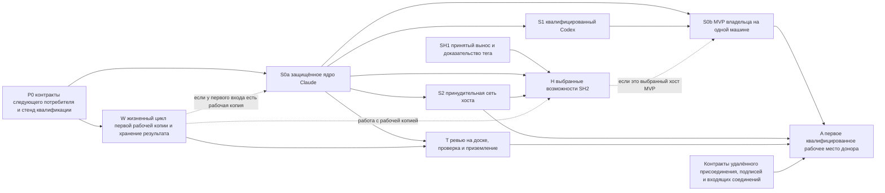

# План реализации Swarma

Статус: черновик для совместного ревью, 13 октября 2026 года. Собирает core astra. План задаёт порядок будущей реализации, квалификации и включения. По нему ни одна квалификация в работе не считается завершённой, и он не разрешает ни развёртывания, ни использования учётных данных. Все восемь черновиков по ракурсам вошли в него как подкрепляющие материалы. Полное совместное ревью идёт до заморозки английского текста; русский перевод делает Opus.

Это перевод `impl/PLAN.md` на замороженной ревизии `b1ca0ce`. Если перевод и английский текст расходятся, прав английский.

## 1. Цель и граница поставки

Сначала строим окончательную защищённую границу запуска и доказываем, как она отказывает и восстанавливается. Потом добавляем потребителей, ради которых она нужна. Сегодняшний рантайм доски задач продолжает работать, пока его модуль сессий выносится отдельно. Первого внешнего работника допускаем только после того, как вместе пройдут квалификацию полный локальный MVP, принудительные границы хоста и путь доставки кода.

О трёх результатах отчитываемся отдельно:

- **SH1** сохраняет принятое поведение доски задач и сессий при выносе модуля. Новой изоляции и новых полномочий он не даёт.
- **S0a** доказывает один защищённый локальный запуск Claude через учётки оператора, брокера, диспетчера, менеджера пользователей и агента, включая полный контракт восстановления малого среза.
- **S0b** — MVP владельца на одной машине, он шире S0a: **Claude и квалифицированный Codex**, отдельные личности ключника, брокера и работника, реальный шов между вызывающим, который собирает план, и хостом, надёжный подписанный почтовый ящик с точными байтами, явная регистрация человеком и задача через цепочку пользователей ОС. Ему не нужны ни доска, ни удалённый харнес. Пройденная контрольная точка с одним Claude — ещё не этот MVP.

Первой вехе внешнего допуска, **A**, вдобавок нужны принудительная сеть, полный путь передачи, ревью, проверки и приземления, а также выбранное сочетание донора и рабочего места. Ни S0a, ни S0b такого разрешения не дают. Метки ниже — вехи планирования, а не новые версии протоколов и не перенумерация срезов выпуска CB7. Исторический `F25` из CIP — не то же самое, что находка ревью F-25.

План сохраняет принятую базу F-1…F-28, включая отзыв F-26, и все 44 подтверждённые находки третьего цикла. Необязательные политики внутри находок остаются выбором. Сама реализация в задачу этого ревью не входит.

## 2. Принципы, которые избавляют от переделок

1. **Окончательная граница — с первого среза.** Одна служба диспетчера на сокете, один запускатель с библиотекой и существующий корневой путь менеджера пользователей. Никакого временного диспетчера в командном режиме, билетов запуска, привилегированного приёмника на доске или второго исполнителя.
2. **Замораживать контракт для следующего реального потребителя, включая отказы.** До реализации интерфейса поставщик и потребитель договариваются о байтах, полномочиях, наблюдении, хранении и восстановлении. Независимые стенды и работа над исходниками SH1 идут, не дожидаясь заморозки всех будущих удалённых форматов.
3. **Различать пять фактов:** решённая семантика, опубликованный черновик, замороженный контракт поставщика и потребителя, выпущенная реализация или доступность функции и квалифицированное включение на названном сочетании хоста и рантайма. Это факты о доказательствах, а не новые состояния рантайма. JSON-схема, ревью исходников, выпущенный бинарник или зелёный общий прогон CI не устанавливают следующего факта.
4. **Привязывать каждое условие к первому использованию.** Локальной рабочей копии уборка нужна до первого запуска; раннему почтовому ящику реальные гарантии хранения и доставки нужны тогда же. Название вехи не переносит на потом обязательства, которые нужны уже сейчас.
5. **Сохранять доказательства при сбоях.** Неизвестный эффект не становится отсутствующим, успешная остановка не стирает обязательство выгрузки, а откат бинарника не возвращает старым полномочиям власть над более поздними записями.
6. **Начинать с минимального поддерживаемого набора.** Один класс доверенных вызывающих, одно начальное сочетание провайдера, один узкий квалифицированный вызов, один инертный путь ревью, один выбранный исполнитель передачи и один бэкенд донора. Обобщать — после того, как полный цикл даст доказательства.
7. **Отделять параллельную разработку от порядка выпуска.** Разработка S1 и S2 может идти внахлёст после общих заморозок. Изменить принятый в CB7 порядок выпуска Claude → Codex → принудительная сеть можно только явным решением.
8. **Измерять принятые изменения.** Учитывать ревью, доработку, квалификацию, удерживаемые ресурсы и внимание оператора. Двадцать четыре места ревью не означают двадцати четырёх полезных авторов кода.

## 3. Вехи, критический путь и параллельная работа

**W** — полный жизненный цикл локальной рабочей копии: развёртывание, работа, остановка и забор, отдельное исполнение программы выгрузки, полномочия на отказ и уборку и надёжное хранение полного содержимого. **T** добавляет импорт в доску, ревью кандидата, проверку на другой машине и приземление. W — условие первого использования, а не требование доделать всех потребителей T, прежде чем что-либо запускать.

**Обозначения:** веха H — это включение сессий на хосте сессий. В привязках проверки B/C/H буква H означает независимо одобренную ревизию харнеса проверки (дайджест набора рецептов или OID защищённой основной ветки). Выбор H для проверки никогда не создаёт для T зависимости от хоста сессий.

Граф показывает технические зависимости. Он не разрешает выпустить S2 раньше и не убирает S1 из MVP владельца. Обычному H доска не обязательна даже при рабочей копии; полный T нужен для выбранной интеграции с доставкой через доску и для A. H нужно доказательство стабильного вынесенного модуля и тега, но квалификация H на одноразовом стенде не ждёт боевого переключения SH1.

| Веха | Объём и ответственные полосы | Зависимости | Доказательство завершения | Начальная оценка |
|---|---|---|---|---|
| **P0** | Владельцы брокера, диспетчера, менеджера пользователей, запускателя и оператора публикуют используемые контракты; инфраструктура даёт реальный стенд границы; владельцы документации выравнивают руководства. | Окончательные пины входных ревизий, названные владельцы поставщика и потребителя, решения по выборам, нужным первому потребителю. | Общие канонические, отрицательные и мутационные векторы, закрытая грамматика ошибок и исходов, реальный стенд учёток, сокетов и дескрипторов, явное предусловие живой лаборатории. | M–L; первая точка калибровки. |
| **S0a** | Установленные учётки оператора и наблюдателя, файловое хранилище брокера и программный корень, служба диспетчера, менеджер пользователей и запускатель v0, одобренный исполнитель Claude под учёткой агента. | P0; поддерживаемое сочетание провайдера; доказательства из разрешённой живой лаборатории; статический запрет до создания учёток; опубликованные выборы первого входа и времени жизни окружения. Если у входа есть рабочая копия, W входит в срез. | Полные доказательства среза 0 из CB7: положительные случаи, отказы, падения, наблюдение, восстановление из копии, время, перепривязка, холодная перезагрузка и ALLSTOP. Аренду получает только исполнитель под учёткой агента. | L; много интеграции, хотя провайдер один. |
| **S1** | Владелец авторизации у брокера, держатель внешнего токена в закрытом app-server и поддерживаемое сочетание харнеса Codex. | S0a; решение по C4; опубликованные контракты сдерживания писателя, исходов попытки и хранилища вендора и уборки; план лаборатории и аккаунтов для обеих платформ. | Реальный вход на поддерживаемом выпуске, политика, обновление токена и его сбой, все случаи замены и ротации из CB7 §9.6 на обеих нужных платформах. | L; поведение провайдера — открытый риск для сроков. |
| **S0b** | Владельцы ключника и личностей, подписанного почтового ящика, реального вызывающего, который собирает план, и хоста, а также провайдеров замыкают цепочку на одной машине. | S0a + S1; регистрация, привязанная к поколению, контракты подписанного намерения и восстановления; выбранный шов. H и S2 нужны, если шов действительно использует H. | Надёжная аутентифицированная задача и результат через названных пользователей ОС на Claude и Codex; чужой подписант, неверные область, поколение или срок и изменённое намерение под существующим ID отклоняются. | L; зависит от выбранного минимального шва. |
| **S2** | Владельцы менеджера пользователей v1, сети и прокси и инфраструктуры реализуют принуждение для учёток и служб, разделение резолверов, заморозку наблюдателем и непрерывный учёт расхода. | Восстановление ядра; замороженные контракты R-NETBIND, отдаваемой политики, слушателей и поколений служб и таблицы машины. Строкам конкретного провайдера нужны доказательства от этого провайдера. | Реальное согласие ядра и отдаваемой политики; векторы обхода, приоритета, сессий, замены и часов; обязательные жёсткие минимумы и явно разрешённые решения по мягким строкам для конкретной машины. | L на каждый поддерживаемый набор границ; равенство ОС не принимается на слово. |
| **W** | Диспетчер, менеджер пользователей, запускатель и передача отвечают за первую рабочую копию и удерживаемый результат. Доска согласует общие представления B, манифеста и результата. | Замороженные контракты эффектов и входа ядра, подходящий квалифицированный профиль и хост; автоматической зависимости от завершённого S0a или полного T нет. | Точный B; отсутствие процессов во всей учётке; ограниченные полномочия на уборку; отдельные квитанции исполнений; проверенный результат и каждый блоб вне области удаления; удержание при отказе и при «неизвестно», аутентифицированное освобождение. | L, общая с T; нужную часть перенести в первый срез с рабочей копией. |
| **T** | Доска отвечает за детерминированный импорт, родословную кандидатов и вердикты; инфраструктура — за задания кандидатов и выбранного неагентного исполнителя внешних эффектов. | Ядро + W; контракты инертного ревью, одобренного рецепта H, раннера и передачи репозиториев и артефактов. | Полный сценарий от развёртывания до приземления, накопленные обязательства доработок, исполнение кандидата без сети, использование результата для текущего точного C и подписанное приземление без force на границе эффекта. | L; несколько владельцев и одна полная цепочка приёмки. |
| **A** | Владельцы удалённого присоединения, моста, реестра, донора A, исполнителя и менеджера рабочего места, доверия, доски и инфраструктуры. | S0b + S2 + T; выбранное сочетание хоста, донора и харнеса; контракты присоединения, набора алгоритмов ключей и входящих соединений, явный допуск; размещение по R-SHARED. | Присоединение → первое задание → разрыв и переподключение → выгрузка и доработка → финальная выгрузка и вывод, с отдельно доказанными остановкой у донора и остановкой рабочего места проекта. | L; первые ворота внешнего допуска. |
| **H** | Хост сессий отвечает за надёжное управление и доставку; раннер агента — за PTY, app-server и аренды; диспетчер — за физический старт и остановку. Доска не обязательна. | Стабильный принятый модуль и тег; ядро и поддерживаемый провайдер; при переезде на служебный UID — аутентифицированные API состояния из SH7:136 вместе с раннерами под учётками агентов; жёсткая готовность v1 из SH7:140 для службы, родительского якоря и резолвера; W, если есть рабочая копия. | Жизненный цикл текущей эпохи, отсутствие и нативная блокировка, квитанции и доставка с неизвестным исходом, удерживаемый вывод и резерв управления, обычные случаи накопленного бюджета перезапусков; необязательные потребители квалифицируются отдельно. | L–XL; оценка источника — 45–100 часов на приземления без доработок или 150–300 с доработками. |

M — ограниченная интеграция одного контракта и потребителя. L охватывает несколько границ процессов и репозиториев и восстановление. XL добавляет жизненный цикл надёжной службы и нескольких потребителей. Это относительные оценки, а не обещания по календарю. Часы по SH2 — исторические оценки из плана источника. Новых замеров часов, токенов или цен вендоров здесь не делали. Переоценить после первого стенда P0/S0a и доказательства F для SH1, с учётом очередей, доступа, ревью и доработок.

Вероятный критический путь — самая длинная из цепочек: квалификация ядра, MVP и провайдеров; принуждение на хосте; полная передача и проверка. За ними идёт интеграция рабочего места. Формат первого входа, реальный хост MVP, хранение результата выгрузки и удалённые входящие соединения решить рано: каждое из них влияет на нескольких потребителей. Параллельно готовить SH1, замороженные векторы, инертное ревью на доске, одноразовые стенды Linux и macOS и исследование провайдеров. Работу G и X над копией исходников вести параллельно, только когда их принятые швы разделены и заморожены. Документация идёт за волной своего контракта; это не общий барьер «сначала дописать книгу».

## 4. Порядок публикации контрактов

Каждый пакет контракта для потребителя называет обоих владельцев, ревизию источника, точные домены, канонические байты и кадрирование, действующее лицо и поколение, ключ идемпотентности в отличие от полного намерения, закрытый набор исходов, время и отмену, надёжное хранение и восстановление из копии, векторы и выключенные возможности. В существующих реестрах держать один типизированный индекс со ссылками на владельцев. Различать нормативные правила, исторические ID аудита, подписываемые домены, дискриминаторы тела, метки транспорта и схем и временные имена. Неоднозначность снимать до эталонных байтов, без массового переименования и без второй службы схем.

| Заморозка | Перед каким потребителем | Что должно быть решено конкретно |
|---|---|---|
| Полномочия и восстановление ядра | P0/S0a | `grant/1`, `revocation/1`, `broker/1`, `dispatch/1`; подписи вызывающих; команда оператора, хранение и повтор; нижние границы эффектов, наблюдения и хранения; R-GEN/R-TIME/R-REBIND/R-LOCK; ALLSTOP как целое действие и отсутствие для поколения, которое ни разу не запускалось. |
| План и привилегированный вход | Первый запуск | Выбранные непрозрачные точные байты или закрытая схема плана с дайджестом; одобренный вызов; один ограниченный неизменяемый жизненный цикл FD3; привязка к окончательному источнику; выбор политики исполнения на стороне машины и пин её тела; реальное замыкание интерпретируемых входов: весь допущенный вызов и всё, что он загружает; решение об уборке аренды, переданной через окружение. |
| Ключник и подписанный почтовый ящик | S0b | Кортеж регистрации и записанный признак разового режима, активный реестр, отсоединение и отзыв; подпись своим ключом и допущенные классы ключей; конфликт полного намерения по `(principal,id)`; доставка, срок хранения и хранилище. Переезд корня брокера, если он нужен, описывается отдельно. |
| Провайдер и живая лаборатория | Реальная квалификация S0a/S1 | Выбранный рантайм и канал, восстановление всех писателей и исходов; явно допущенные артефакты платформы и вендора; регистрация и владение аккаунтом, хранение, сдерживание, выгрузка с вычищенными секретами и сворачивание; обязательное явное разрешение на лабораторию. |
| Сеть и общий dial guard | S2 и использование N16 в T | Идентификаторы политики, блокировки, слушателя и службы и дайджест отдаваемой политики; жизненный цикл ядра и прокси; полные диапазоны исключений guard; точное утверждение о CONNECT; непрерывность окна учёта; таблица резолверов и сокетов; порядок, снятие и версии наблюдателя и объём уведомлений. |
| Хранение результата локальной рабочей копии | W | Канонический манифест режимов, типов и содержимого для неизменяемого B, связь с архивом, область плана, отдельные физические исполнения, ограниченное согласие на уборку и ёмкость под неё, удержания по безопасности, надёжность полного содержимого, аутентифицированные получение и освобождение, отказ и исправление. |
| Доставка кандидата | T | Независимый пересчёт B доской, импорт и идентификатор C, доверенная интеграционная база ревью и накопленные флаги, инертное ревью и вердикт; разделение N16 на загрузку и работу без сети; задание и результат, привязанные к B/C/H; выбранный исполнитель эффектов и проверки каждого эффекта. |
| Удалённая работа | A; B отдельно | Режим присоединения, пакета и первого контакта, набор алгоритмов подписи, владелец формата канала и бэкенда, надёжные заявки и наблюдения; создание входящих соединений и общее время жизни ретрансляции, задания, выгрузки и переподключения. B получает свой компонент подготовки и своих принципалов для инференса, обновления токенов и локального управления. |
| Возможности хоста сессий | Первый H или более ранний реальный потребитель | Текущее согласие на жизненный цикл, разрешение на сессию и заявки на каждый старт; аутентифицированный раннер и текущая эпоха, судьба процессов, доказательства доставки, резерв хранения и управления. Инициатор перезагрузки, адаптер доски, делегирование, цели и другие необязательные пути замораживаются только перед использованием. |

Сейчас LR6 требует в плане раздел рабочей копии. Узкое доказательство S0a без рабочей копии, опубликованное совместно, предпочтительно, только если владельцы запускателя, диспетчера, менеджера пользователей и брокера могут описать его без угаданных пустых значений и обойдённых проверок. Иначе W входит в приёмку S0a. Полный T не предшествует S0a. По той же причине обычному H с рабочей копией доска не обязательна.

Реальные механизмы FD3 и вызова, а также уборки окружения выбрать до того, как писать их потребителей. После успешного exec в режиме окружения клиента брокера больше нет. Разрыв соединения, выход процесса или выдуманный поздний обратный вызов не заменяют выбранный контракт освобождения и удерживаемой записи. Для начального аутентифицированного допуска диспетчера к корневому помощнику через sudo и роль подписанные гранты менеджера пользователей v2 не нужны; пути через sudo от вызывающего к диспетчеру нет. Необязательная выгрузка служебных метаданных может оставаться выключенной; обязательство по рабочей копии это не отменяет.

Совместный пакет входа оператора в P0 должен до заморозки потребителя S0a выровнять сокращённые формулировки ALLSTOP в CB7 :739/:807, DP7 :433 и UM7 :514 с UM7 :112/:538/:542. Сохраняются аутентификация плюс одно подтверждение действия для всего узла через любой из двух защищённых путей; терминал с паролем и без кэша по-прежнему не зависит от телефона. Опубликовать согласованные для каждого пути привязку к содержимому, доказательства происхождения и защиты от повтора и векторы квалификации. Короткие пересказы не дают терминалу исключения. Это выравнивание источников внутри уже идущей работы по публикации, а не новая необязательная политика, не второй запрос и не выбор механизма интерфейса или формата.

## 5. Безопасность и приёмка при первом использовании

### Защищённый запуск и локальный MVP

S0a несёт все обязательства малого среза CB7: обязательный отказ по классу, каноническую проверку, текущие время и отзыв, привязку, отвязку и удерживаемые наблюдения, перепривязку, исходы и отсутствие, забор при восстановлении из копии, порядок блокировок и журналируемый ALLSTOP с явным восстановлением. До первого старта квалифицировать защищённый выбор профиля исполнения и весь допущенный вызов целиком. Одобренный путь интерпретатора не разрешает исполнять локально код, конфиги, плагины и импорты от работника; такое исполнение — дело R-VERIFY.

Допущенные дайджесты поверхностей, которыми владеет план (R-STANDING), проверяются до первого запуска, перезапуска или возобновления постоянной сессии — когда бы этот потребитель ни включили. Дерево кандидата, открытое позже, — не поверхность плана; для него действуют свои ворота инертного ревью.

Хранение ключей не смешивать. Программный корень брокера и серверные полномочия — под `swarma-operator`. Закрытый ключ устройства — в защищённом железе телефона. Ключ вызывающего диспетчера, привязанный к поколению, — у вызывающего. Ключи личностей от ключника — по их собственному контракту. Интерактивная учётка человека — не хранилище ключей платформы. Действия оператора из сессии агента отклоняются; расширение требует аутентификации и подтверждения точного содержимого, а сужение — аутентификации. R-ALLSTOP требует аутентификации плюс одного подтверждения для всего узла через телефон или терминал, как описано в UM7 §11. Терминал работает по паролю, без кэша и не зависит от телефона; второго запроса или неопубликованного интерфейса это не предписывает. Обычному сужению и уже допущенным действиям служб дополнительное подтверждение не нужно. Наблюдатель читает только опубликованную несекретную поверхность. Обычная уборка, которая уже разрешена, остаётся обычной работой служб, а не новой ручной церемонией оператора.

Статический запрет на диапазон ставится до создания учёток, с пробами приоритета при установке, при старте службы и по расписанию. Правило диапазона v0 пропускает объявленные слушатели прокси платформы. Оно не доказывает ни отсутствия исходящих сокетов, ни изоляции собственного порта v1. Доступность Unix-сокетов квалифицируется отдельно. Каждый класс получает свои реальные опубликованные минимумы. Первому доверенному классу хватает базы v0 и квалифицированных объявленных строк. Недоверенному нужны жёсткие строки: число процессов, принудительное ограничение исходящего трафика, исполнение программ и изоляция временных каталогов. Память, CPU и диск — по реальным строкам таблицы машины и явному разрешению мягких строк для конкретной машины через любой из двух защищённых путей оператора. Одно название ОС ничего не допускает и не исключает.

ALLSTOP доставляет одно и то же действие оператора напрямую и с аутентификацией каждому получателю, поэтому независимые сетевые отсечения и остановки продвигаются, даже когда диспетчер или брокер недоступны. Но завершение и повторное открытие требуют всех надёжных частей служб, включая сверку диспетчера. Прежде чем объявлять окончательное отсутствие, закрыть забором создание, старт и входящие соединения. Для поколения, которое ни разу не запускалось, нужно свежее авторитетное покрытие «запуска не было» плюс отсутствие за забором, а не пробный старт, вывод из отсутствующей квитанции или общий kill по UID. Не записывать офлайн-состояние чужой службы.

После S1 срез S0b добавляет настоящие компоненты: ключника, почтовый ящик и шов. Подписанные байты хранить целиком и сравнивать полное каноническое намерение под существующим ключом `(principal,id)`. Изменённое намерение — конфликт, а не новый запрос с ключом по дайджесту. Данные от пиров никогда не получают полномочий оператора. У сверки доставки три ветви. Положительное доказательство применения закрывает вопрос: сообщение применено, повторной доставки нет. Подтверждённое неприменение по неповреждённым доказательствам разрешает только опубликованный допустимый повтор обычного ввода при текущих воротах. Неразрешённые доказательства остаются «неизвестно» за забором, а неизвестные одобрения и управляющие действия никогда не повторяются автоматически. Положительная квитанция не снимает посторонних удержаний жизненного цикла или безопасности. SH2 использует свои квалифицированные доказательства из транскрипта; другой ранний шов почтового ящика должен опубликовать свои равноценные доказательства, а не полагаться на эту реализацию. Общие делегированные действия хоста закрыты, пока не опубликован реально строимый путь зарегистрированных действий. Любой ранний надёжный почтовый ящик или вывод хоста сразу подпадает под свои бюджеты, резерв под доказательства и контракт восстановления.

### Рабочая копия, ревью, проверка и приземление

Вывод проходит три разных барьера. Подтверждённое отсутствие процессов во всей учётке может освободить ёмкость исполнения. Проверенный надёжный результат **и каждый блоб, на который он ссылается**, вне области удаления могут разрешить вывод дома и UID ещё до импорта в доску. Удерживаемое содержимое освобождается только аутентифицированным подтверждением импорта или другим разрешённым решением. Дайджест, указатель или квитанция с одними метаданными сами по себе не доказывают хранения полного содержимого.

W публикует полномочия только на уборку. Они привязаны к исходному допуску, к точным поколению, раунду, программе выгрузки, базе и области и к ограниченной ёмкости, в том числе после обычного истечения срока работы. Права на исправление работником или унаследованных полномочий R-SESSION они не дают. Отзыв, компрометация, восстановление из копии, обслуживание и ALLSTOP сохраняют свои явные барьеры. У развёртывания, работы, выгрузки и любого исправления — отдельные связанные физические заявки, квитанции и доказательства отсутствия. Выгрузка с исходом «неизвестно» или «отказ» удерживает нужные обязательства по учётке, дому и UID даже после освобождения ёмкости исполнения. Ограниченному исправлению нужны текущие полномочия на работу и новые эффекты; неизменный детерминированный отказ может и дальше держать ресурсы до разрешённого решения. Постоянно действующее разрешение на отбрасывание отклонённых выгрузок — вариант владельца, который пока не выбран. Отказ из-за прав доступа к файлам и каталогам, созданным работником, квалифицировать отдельно от сбоя инфраструктуры; никакого обхода через чтение от root или chmod.

W до начала работы проверяет соответствие архива манифесту B; T при импорте независимо пересчитывает полный манифест режимов, типов и содержимого из B в репозитории. Доска импортирует с независимым администрированием Git и выключенными хуками, фильтрами и драйверами и получает точный C. Флаги ревью выводятся из доверенной интеграционной базы, отдельной от B развёртывания и от H проверки. Доработка от C1 к C2 заново допускает свою неизменяемую базу и пересчитывает унаследованные обязательства по чувствительности и происхождению. Подтверждения и вердикты привязываются к C2, в том числе когда дерево то же, а коммит другой.

Ревью начинается с диффов и блобов точного C вне каталогов, где харнес ищет настройки. Вход в дерево кандидата требует квалифицированного строгого адаптера контекста, который покрывает запуск, вложенные чтения, перезагрузку, возобновление и вход дочерних агентов. Принятие кандидата не допускает его инструкции, хуки, MCP и скиллы как управление. Инертная подача не убирает риск промпт-инъекции; проверка права ревьюера на ревью и проверки на границе эффектов по-прежнему нужны.

N16 загружает зависимости ограниченным инертным путём без хуков, кода, плагинов и установочных скриптов кандидата. Только после конца загрузки сборка и тесты кандидата исполняются без внешней сети, резолвера и унаследованного сокета службы исходящего трафика; loopback внутри раннера может остаться. Недостающие зависимости дают отказ без сети. Одобренный H поставляет драйвер и рецепт вне C; записываемые артефакты и кэши кандидата не могут загрязнить управление или другое задание. Запасного пути через учётку агента или машину оператора нет.

Задание и результат привязываются к OID и дереву C, к B, H, артефакту, рецепту, образу и лимитам. Поздний успех **или провал** J1 после выбора C2 обновляет только историю J1: он не засчитывается C2 и не откатывает его. Текущий кандидат и запрос проверять в момент перехода состояния. Дубликаты и исходы после падений сохранять. Единственный ограниченный повтор при сбое инфраструктуры из черновика никогда не превращает настоящий провал теста в успех.

Для отложенной публикации, передачи артефактов, обновления базы и приземления выбрать **неагентного исполнителя**: существующего, на другой машине или явно через оператора. Описать его вызов, хранение учётных данных и ключей подписи, маршрут и результат. Каждый эффект проверяет свои предусловия у исполнителя. Отложенная публикация проверяет импорт и пространство имён, которое уже квалифицировано на реальном хосте репозиториев как свободное от CI при всех триггерах workflow. Инвариант фильтра workflow держать на пине; локальное имя, запасная ветка или «опубликовать и посмотреть» — не квалификация. Приземление вдобавок заново проверяет текущий вердикт для точного C, обязательные подтверждения, проверку и защищённую основную ветку. Сохранять подписанную перемотку без force; если основная ветка ушла вперёд, нужен опубликованный путь со свежим кандидатом, ревью и проверкой. Обязательный новый демон или строка локальной службы появляются, только если этого требует выбранная топология. Входящие соединения к раннеру из закрытой сети или tailnet — не обычное добавление в белый список N15.

### Принудительная сеть и первый донор

S2 квалифицирует принуждение в ядре вместе с реально отдаваемой политикой прокси, поколением учётки и службы, путями резолвера и сокетов и уже идущими сессиями. Вернуть полные исключения dial guard. CONNECT ограничивает authority туннеля (имя хоста и порт) и адрес назначения. Origin приложения во внутреннем протоколе, который прокси не видит, и веб-действия на стороне провайдера он не ограничивает; перехват TLS не добавляется. Расход принадлежит личности и окну и переживает замену слушателя, повторное применение политики, перепривязку и падение службы. Неизвестный расход закрывает деятельность, которая тратит бюджет, если только консервативная граница или резерв не устанавливают остаток лимита, в том числе при замене внутри того же окна. Недостоверное время никогда не создаёт нового лимита. Опубликованная семантика окна сохраняется; ни скользящий учёт за 24 часа, ни fsync на каждый байт не предписываются. Одни настроенные потолки — не доказательство расхода.

Остановку, удержание и статус наблюдателя v0 описать честно. Полная заморозка отдельной учётки — это v1: более новое сужение побеждает устаревшее повторное применение, закрывает затронутые потоки и переживает нужное восстановление. Снятие заморозки — разрешённое расширение, отдельное от перезапуска и от независимых удержаний по безопасности. Остановка никогда не ждёт подтверждения от сети или от оповещения. Маршруту оповещений нужны владелец, ограниченные типизированные доставка и хранение и поведение при недоступном канале. Явный этап «только статус» допустим и не обещает доставки на телефон.

Заморозка учётки наблюдателем может пропустить квалифицированную фиксированную программу выгрузки под её собственными ограниченными полномочиями на уборку, без сети и без исполнения кода работника. ALLSTOP всего узла отдельно держит физические старты до своего собственного восстановления. Ни уборка, ни снятие заморозки наблюдателя не обходят других действующих удержаний по безопасности и не дают работнику прав на исправление.

A допускает одно выбранное сочетание недоверенного рабочего места: жёсткие обязательные минимумы, нулевой исходящий трафик, включая loopback, ни аренды, ни привязки на хосте, никакого локального цикла харнеса и только объявленный набор сокетов платформы. R-SHARED не допускает общие **неплатформенные** службы рядом с недоверенной работой. Одно членство в доверенном круге не даёт ни прав ревьюера или цикла на хосте, ни ослабленной границы рабочего места. Отдельно допущенные условия класса, роли и размещения и канонический предел добровольного согласия донора сохраняются.

Входящие соединения, ретрансляцию, задание и старт, выгрузку, переподключение и остановку заморозить как одно физическое время жизни. Входящий SSH и незавершённая аутентификация могут заново создать процессы под UID, несмотря на запрет исходящего трафика. Поэтому создание процессов этого поколения закрыть до того, как засчитывать тишину как отсутствие, и держать забор на время выгрузки. Окончательный вывод сертификата и канала — не то же самое, что переход к следующему раунду, который можно повторять. Один постоянный раннер не обеспечивает затихания ретрансляции.

Квалификация от присоединения до результата включает порядок приглашения, проверочного запроса (challenge) и пакета, атомарный повтор регистрации тем же ключом, допущенный у работника набор алгоритмов P-256 и неизменную проверку финального конверта. Первый контакт всегда проверяет WebPKI. Выбранный режим с локальным DNSSEC проверяет свои доказательства и пины приглашения, если они есть. Только заранее объявленная среда без DNSSEC выбирает ветку с пинами приглашения до DNS-запроса, а затем проверяет обязательные пины и WebPKI. Сбой никогда не понижает режим. `init` донора запускает владелец машины; службы проекта не хранят учётных данных провайдеров донора. Для A нужны отдельный публичный хост точки присоединения, владелец входящих соединений и бюджет на них. Ключа подписи допуска на этом хосте нет, а CA хранится вне рабочего места и ретрансляции. То, что у варианта A нет изоляции на стороне донора, остаётся записанным явно. Исправления компонента подготовки и принципалов для B и более позднее развёртывание C не задерживают не связанных с ними потребителей A.

## 6. Вынос SH1 и граница SH2

Сегодняшний состав доски сохраняется: завершение задач и запусков, маршрутизация, реестр целей, приземление CR и репозиториев и обёртка `tb-sessiond` остаются обязанностями доски. При копировании не добавлять полномочий SH2, нового авторства целей и новых обещаний надёжности. Одобренная арбитром заморозка исходников задаёт точную матрицу провайдеров, транспортов, нативных целей, команд и маршрута запуска через хост сессий (hosted). Более новая замеченная регистрация Muse — изменение источника, которое надо учесть, а не доказательство C7 или квалификации целевого запуска через хост сессий.

| Ворота | Требуемый результат | Порядок и владелец |
|---|---|---|
| **F** | Представительное доказательство реального итогового графа зависимостей; перечни и хэши неизменённых тестов, настоящие мутации конвертеров и охранных проверок, явные провалы базы. F остаётся предварительным, пока O не закроет точную базу скопированных байтов. | Владелец выноса и ревьюер, до заморозки швов. Сборки и vet потребителя-прототипа, псевдоверсии с файловым прокси и чтения охранных проверок без инструментирования недостаточно. |
| **O** | Полный рекурсивный снимок пакета и подпакетов, неизменённые тесты, фикстуры, эталоны и ресурсы не на Go, с закреплённым происхождением файлов, режимов и хэшей, NOTICE и перечнем провайдеров и рантаймов; ревью происхождения и утечек до первого публичного пуша исходников. | Владельцы исходников и доски; перенос истории не нужен. Принятые изменения из upstream свести до копирования. |
| **G / X → Y** | Непересекающиеся нейтральные швы и изменения в скопированном модуле, затем сведённая интеграция с сохранением владения и поведения. | Параллельно только после заморозки интерфейсов; без конкурирующих правок и без нового сервера доски. |
| **Z** | Неизменяемый тег и три отдельные полосы: неизменённая закрытая проекция, вся доска как потребитель неизменяемого тега и соответствие модуля. | Облачные раннеры macOS и Linux и правила для закрытых исходников; без утечки учётных данных и сырых закрытых артефактов. |
| **C1** | Парное боевое переключение доски и модуля: все входы затихли, один писатель состояния, смысловая совместимость старого и нового, безопасный откат. | Окно обслуживания оператора **не раньше 19 октября 2026 года**; это нижняя граница по календарю, а не назначенная дата. |

Историческая оценка SH1 — 18–24 последовательных часа на приземления без доработок или 60–72 с доработками, включая само приземление. Переоценить после F; ни 24 места, ни длительность CI прототипа не умножают пропускную способность. До C1 текущая работа продолжается как есть.

После O старый источник замораживается, и назначается один интегратор переноса вперёд. Каждый принятый перенос незаконченной работы записывает исходный коммит, коммит назначения и идентификатор проверки; идущие ревью заканчиваются на своей исходной базе. После каждого принятого переноса заново построить базу и перезапустить затронутые доказательства. Не развивать два меняющихся рантайма параллельно.

C1 закрывает автозапуск обёртки, защищённое автоматическое обновление протокола, пути по расписанию, восстановления и оператора и раннеры доски. Публикация тега или облачный CI потребителя не разрешают поставить обёртку, которая раньше времени заменит работающий демон. Все четыре пары старой и новой обёртки и демона квалифицировать по смыслу, а не только по успешному подключению. Сохранять точное подтверждение цели, отказ при незавершённой привязке, завершение по доске и восстановление повтором из надёжного финального события. Если объявленный контекст цели недоступен, нужен отказ до эффектов, а не тихий переход к работе без цели.

Для SH1 использовать разрешённые средства обслуживания текущего хоста. Общая схема «остановить, заменить, проверить совместимость» не делает будущие `swarma-operator`, диспетчер и менеджер пользователей, R-SESSION или ALLSTOP новым предусловием C1. PTY Claude, которыми владеет текущий демон, при его замене завершаются; не обещать, что эти PTY прозрачно переживут переход к SH2. При откате сохранять все более поздние принятые записи; старый снимок — не короткий путь миграции.

H — отдельная реализация за своими воротами. Доказательства стабильного модуля и тега идут до включения; H на одноразовом стенде может пройти квалификацию раньше боевого C1. При переезде на служебный UID прямой доступ к файлам уведомлений и контекста заменить аутентифицированными API и одновременно ввести раннеры под учётками агентов. Лаборатория без целей работает на изолированном целевом состоянии, а не с расширенными правами на живые файлы доски. Проверенные доказательства v1 для службы хоста — запрет всего, родительский якорь и резолвер — обязательны и без целей. W идёт до работы с рабочей копией; полный T нужен только для выбранной интеграции с доставкой через доску и для A.

Остановку через диспетчера, проверку нативной блокировки свежим раннером и проверки текущей поверхности и личности квалифицировать отдельно. Обычные преемники сохраняют накопленный или отсчитываемый от первого старта бюджет перезапусков и время жизни учётки при замене контроллера или исполнения и при перебоях у провайдера; исчерпанный бюджет — отказ в следующем преемнике. У постоянных сессий своё правило без предела исполнения и текущее разрешение на преемников. D-RESUME сохраняет решённый путь на той же машине по semver без ломающих изменений, без лишней строки квалификации на смену версии; сообщать `resume-failed` без автоматического запасного пути. Целями владеют вызывающий и доска; необязательные собственные цели агента и автоматический инициатор перезагрузки остаются за отдельными воротами.

## 7. Среды квалификации и доказательства

Четыре случая доверия держать явно раздельными:

| Полоса | Что можно доказать | Граница |
|---|---|---|
| Облачный CI SH1: проекция, потребитель, модуль | Доверенный вынос на пине и совместимость всей закрытой доски с тегом. | Действуют существующие правила закрытого checkout и артефактов; доказательства прототипа не доказывают ни выпуска, ни изоляции платформы. |
| Привилегированная квалификация платформы на одноразовом стенде | Реальные переходы root, служб и агентов и реальное принуждение ОС; кандидаты — облачный macOS и одноразовый Linux. | Привилегии принадлежат одноразовой тестовой среде. Недоступный бэкенд означает «не поддерживается», а не «пройдено» для заявленной ОС. |
| Проверка кандидата на эфемерном раннере | Исполнение недоверенного C на другой машине без секретов по N16, в квалифицированной VM или за другой доказанной границей изоляции. | Отделить управление пулом, другие задания, записываемые кэши и надёжное состояние. Linux на OVH — кандидат на размещение, а не пройденная квалификация. |
| Отдельно разрешённая лаборатория с живыми провайдерами | Реальные доказательства аренды и выдачи учётных данных для S0a и входа и ротации для S1 на явно допущенных артефактах платформы и вендора. | До запуска опубликовать владение аккаунтами, церемонию, хранение, сеть и сдерживание, вычистку секретов и сворачивание, а также любое нужное исключение из общего правила «тесты без секретов». |

Код и тесты кандидата остаются без секретов и после приёмки точного C. Сами принятые байты не дают права на живую лабораторию. Исторические исключения для входа в отдельных строках и наблюдения за провайдерами — доказательства в своих рамках, а не постоянное разрешение и не пройденная проверка текущего поддерживаемого выпуска. CB7 исключает один аккаунт вендора на нескольких машинах без отдельного дизайна владения, в том числе при последовательных церемониях. Самое малое начальное предложение — отдельные выделенные тестовые аккаунты на каждого независимого владельца хоста; любое повторное использование сначала разрешает вопрос прежнего писателя и неоднозначных исходов ротации и хранилища. Без полномочий на лабораторию зависимая живая приёмка стоит, а синтетическая и контрактная работа идёт.

Каждый пакет включения привязывает пины контракта, реализации и инструментов, точные ОС, ядро, бэкенд и образ хоста, дайджесты харнеса, точки входа и политики, нужные принципал, поколение, эпоху и эффект и идентификаторы B/C/H и артефактов. В него входят положительные контроли, точные отрицательные проверки, обрывы в критических точках, наблюдаемые исходы и удерживаемые обязательства. Независимое ревью указывает, что именно было проверено. Пропущенные, устаревшие, неподдерживаемые, частичные или неизвестные доказательства никогда не засчитываются. Мутант для проверки безопасности должен дойти до своей целевой проверки при зелёной базе; ошибка компиляции или постороннее красное — не «убийство» мутанта.

Общий корпус покрывает падения до намерения, после намерения и до эффекта, во время эффекта, после сохранения результата с потерянным подтверждением и во время восстановления; исходные ID и аргументы не меняются. Включить повторное использование UID, старые обратные вызовы, заборы перед окончательной выдачей учётных данных, изменённое подписанное намерение, время, сон и перезагрузку, исчезновение писателя в сравнении с исходом у вендора, восстановление из копии и обе находки про ALLSTOP. Наблюдение не создаёт работы. После медленного внешнего ввода-вывода блокировка проверяется заново; ни одна блокировка состояния не держится на время синхронного вызова другой службы.

Отрицательным сетевым проверкам нужны живые положительные контроли для точки и протокола и правильная привязка к действующему лицу, чтобы отличить отказ политики от мёртвого слушателя, DNS или провайдера. Прежде чем проверять сужение, доказать, что трафик шёл. Проверять реальные пути резолвера, уже установленные потоки прокси, другую незатронутую личность и замену службы. Никогда не выключать сдерживание на допущенной боевой машине ради контроля. Границы периодического обнаружения записывать, не называя их непрерывной проверкой.

Затронутые строки квалифицировать заново, когда меняются их контракт, код, сочетание рантайма или входы принуждения. Повторно использовать авторскую работу и инструменты, а не чужие утверждения о квалификации. Этот коллектив планирования не делал ни сборок, ни тестов, ни регистрации учётных данных, ни активных проб.

## 8. Эксплуатация, обслуживание и восстановление

Для первого интегрированного стенда управления и восстановления предпочесть одноразовый Linux, параллельно собирая доказательства на облачном macOS. Развёртывание выбирать по полным измеренным возможностям, а не по репутации ОС. Перегруженный Mac mini оператора остаётся на рабочем рантайме, пока замена не пройдёт квалификацию и оператор не назначит реальное окно обслуживания. Тяжёлая квалификация и исполнение кандидатов — на других машинах.

Защищённое управление для наблюдения и восстановления открыть раньше, чем готовность к новой работе. Статус отличает приём от доступности управления, восстановление из копии от ALLSTOP, неизвестные эффекты и писателей от завершённых исходов и называет нужную сверку. Отсутствие диспетчера никогда не открывает замещающего пути приёма, запуска или новой работы; существующий аутентифицированный путь остановки ALLSTOP напрямую к каждому получателю остаётся доступен. Неопределённость одной записи может закрыть забором только эту запись; неопределённость общего учёта закрывает приём на всём узле.

При каждом старте службы и по опубликованному установщиком ограниченному расписанию под управлением root проверять нужные строки служб, запрет на диапазон и действующий приоритет, родительские якоря и состояния ядра, поколение слушателей и отдаваемой политики и ограничения резолвера. Если доказательства нет, оно не совпадает или не читается, затронутая принудительная готовность снимается, а новые полномочия удерживаются. Сообщать и восстанавливать через опубликованный ответ R-MAINT/R-FATE, без неявного kill всех исполнений юнита. До включения опубликовать точку входа, интервал и порядок ответа и записать окно обнаружения. Доказательство на одноразовом стенде — не постоянная готовность целевой машины и не непрерывное принуждение.

Для обслуживания **платформы**: подготовить старые и новые артефакты на пинах и совместимость читателей и писателей, перечень затронутого, судьбы процессов и обязательств; до того как действие начнёт что-либо закрывать и менять, получить и надёжно записать текущее разрешённое действие оператора; закрыть все нужные входы — приём, создание, запуск, входящие соединения; остановить и сверить всех нужных владельцев; заменять только при полных доказательствах; восстановить управление и проверить текущие полномочия, время, восстановление из копии, ALLSTOP и сеть; разрешённые входы открыть последними. Подготовка только на чтение идёт до действия. Неизвестные результаты удерживают окно: приём остаётся закрытым. Обычная уборка служб сохраняет уже выданные полномочия. Для SH1 есть аналог на существующем рантайме, описанный в §6; совмещённая миграция явно проходит оба набора ворот.

| Событие | Что делать |
|---|---|
| Новая версия падает, уже сохранив новые записи | Откатываться можно, только если старые читатель **и писатель** понимают и поддерживают каждую удерживаемую более позднюю запись, схему и обязательство и создают совместимые по смыслу последующие записи состояния. Порядок тот же: отсутствие за забором, сверка, замена. Неподдерживаемое состояние — отказ в откате; одного сохранения незнакомых байтов недостаточно. Иначе приём остаётся закрытым, а исправление идёт вперёд; старый снимок поверх не накатывать. |
| Восстановление из копии открывает старые полномочия | Закрыть забор до того, как восстановленные байты станут видны, и закрыть всех прямых читателей и автозапуски. Отметку восстановления и полные доказательства свежести держать вне области отката. Восстановить подтверждённую историю **или** явно объявить недействительными все старые настроенные корни авторизации брокера и заново выдать полномочия в области авторизации брокера (гранты и привязки — по новым решениям оператора). Это не заменяет постоянные ключи D-IDENTITY и SSH CA; реестр, время, эффекты и исходы у вендора по-прежнему сверяются отдельно. |
| Восстановление из копии и ALLSTOP одновременно | Снимать каждое своим полным разрешённым восстановлением. Перезапуск, снятие заморозки наблюдателя или один снятый забор не снимают другого. |
| Холодная перезагрузка | До приёма и выдачи учётных данных восстановить приоритет статического запрета и доверенное время, свести исполнения под супервизором к «потеряно» или отсутствию, как описано, и сохранить остановленные постоянные учётки без автоматических новых стартов. |
| Замена владельца учётных данных | Доказать отсутствие старого писателя и его потомков и отдельно сверить исход ротации и хранилища у вендора. Один мёртвый PID не разрешает повтор обновления токена. |
| Выгрузка или проверка совпадает с обслуживанием | Сохранять идентификаторы каждого результата, блоба, кандидата и задания и все незакрытые обязательства. Поздние ответы заданий обновляют свою историю, а не текущего кандидата. Резервы хранения и управления переживают замену. |

Обычные бэкапы по-прежнему разрешены; реальные точки входа восстановления обязаны вызывать процедуру за забором. Свидетель, восстановленный вместе с той же машиной, свежести не доказывает, а локальная метка времени не обнаружит произвольного отката всей машины. Явно записывать пределы восстановления, а не заявлять неуязвимость к произвольной потере диска.

Покрытие получателей до восстановления считать `unavailable`, а не `not_recorded`, пока его не восстановят независимо. Сверять в обе стороны: записи диспетчера, его учётки в менеджере пользователей, привязки брокера и уцелевшие квитанции. Объекты без пары сохраняют свои идентификаторы и консервативные обязательства по квотам, ёмкости и выгрузке, пока оператор явно не подпишет решение: вывести объект или заново принять его запись. Одни имена или UID не разрешают ни удаления, ни принятия. Повторное принятие записи не даёт новых полномочий на работу или старт и не означает подхвата живого супервизора. Поколение, известное как выводимое или удалённое, никогда не возвращается в активные. Форматы перечня и решений опубликовать до первого потребителя восстановления; при потерянных доказательствах ограниченное восстановление может оказаться невозможным.

Окна провайдеров, горизонты полномочий, срок учётки и физическое время исполнения не смешивать. Обычные значения по умолчанию: учётка — 24 часа (максимум 7 дней), исполнение — 4 часа (максимум 12); у постоянных — своё правило без предела. Сброс окна у провайдера ничего из этого не продлевает. Перепривязка меняет только названную привязку учётных данных, но не согласие на преемников, не удержание наблюдателя и не ALLSTOP. Истечение срока по-прежнему идёт через квалифицированные остановку и уборку; выгрузка с исходом «неизвестно» или «отказ» сохраняет своё обязательство.

Предлагаемая политика темпа для H: опубликовать для поддерживаемого харнеса положительную классификацию ограничения со стороны провайдера в текущих исполнении и эпохе, ограниченное подавление повторов и закрытую на это время доставку. Неизвестные сбои, сбои аутентификации и транспорта восстанавливаются своим путём; неклассифицированный вывод и устаревшие подсказки о сбросе не меняют текущей готовности. Сброс окна даёт только право снова рассмотреть повтор. Он никогда не будит автоматически из явной парковки или удержания по безопасности и не служит доказательством, что доставка не применилась. Пока политика по конкретной причине не прошла квалификацию, использовать существующий разрешённый путь. Доказать, что нет дублей доставки на платформе и бесконечной смены преемников; не обещать, что контекст никогда не уйдёт вендору повторно.

## 9. Работники, стоимость и прогноз

На каждое ограниченное изменение — один автор, независимый ревьюер с правом ревью, владелец квалификации и свободная ёмкость на приземление. Новую линию работ открывать, только когда есть эти ресурсы и замороженные интерфейсы. Сохранять существующую политику выбора на доске и в проекте и записывать запрошенные и фактические модель, усилие, харнес и уровень обслуживания. Текущая позиция владельца: сначала подписки, оркестрация не привязана к модели; оркестратор — Opus 5.5, работники — Sonnet 5.5, Luna Max допустима как работник, но не как оркестратор. Codex работает в стандартном режиме обслуживания; быстрый режим убран. Это запись политики владельца, а не сравнение вендоров.

Рутинная ограниченная работа может идти на допущенной базовой модели работника. Для привилегированного запуска, учётных данных, парсеров, заборов, восстановления и целостности предлагается сильный допущенный автор, глубокое ревью и вторая независимая состязательная проверка. Opus как решающий ревьюер везде — рекомендация, расширяющая решение по конкретной задаче о секретах в архиве, а не принятое всеобщее требование. Существующие права на ревью точного C и разделение автора и ревьюера по-прежнему действуют. Необязательное правило «только локальный ревьюер» и исключение запросившего остаются выбором владельца. Muse может давать независимое ревью и исследования, когда она доступна и допущена; присутствие в реестре и её приоритетный, но не квалифицированный канал подписки — не обещанная производственная ёмкость. Итоговый план для оператора переводит Opus.

Калибровать **всю серию принятых изменений**, а не один удачный прогон. Записывать токены по статьям — подготовка контекста на доверенной стороне, сбор и обновление пакета входных материалов, автор, ревью, доработка, разбор квалификации и закрытие — по фактическим провайдеру, аккаунту и модели. Кэшированные, входные и выходные токены разделять без двойного счёта. Наблюдения за окнами подписки держать отдельно от сумм токенов и денег. Добавлять время раннеров и очередей, хранение и передачу данных, церемонии, хранение учётных данных и сворачивание живой лаборатории и действия оператора. Две машины, которые видят одно общее окно провайдера, — это не два лимита.

Начальный резерв пилота: один ограниченный автор с обязательной парой ревью, квалификация и один полный цикл доработки. Повторить на двух следующих сопоставимых изменениях и сообщить наблюдаемые диапазон и максимум, а не выдуманный перцентиль. Затем назначить бюджеты срезов, раздельно по провайдерам:

`бюджет среза = подготовка контекста + автор + ревью + резерв на доработку + разбор квалификации + закрытие`

Числовые бюджеты остаются **не измеренными** до этого пилота. Пересчитывать прогноз, когда контракт открывается заново, меняется рантайм или появляются новые векторы. Второй полный цикл доработки — повод сузить объём или обычным порядком попросить владельца задачи продлить бюджет. Уборку и хранение учитывать до первого допуска рабочей копии, даже если W внутри S0a/S0b, а отдельный хост точки присоединения посчитать один раз до прогноза ёмкости доноров.

Плановые бюджеты — не точные отсечки расходов. Выданные учётные данные и работу, уже принятую вендором, локальная заморозка аренды не отзовёт; потолки байтов и запросов на непрозрачном CONNECT — не счётчик токенов. Использовать существующее планирование и разрешённые пути остановки и заморозки; не добавлять ни демона квот, ни неподдерживаемого условия конкурентности в брокере, ни предела жизни для постоянных. Лимит провайдера у донора держать отдельно, но затраты проекта на развёртывание, выгрузку, хранение, ревью, раннеры и оператора всё равно учитывать. Вывод проекта не доказывает ни остановки у донора, ни отзыва учётных данных у вендора.

Ёмкость на ревью и доработку резервировать раньше, чем запускать ещё одного автора. При отказе провайдера сохранять личность, контекст и эффекты и идти квалифицированным путём восстановления; смена провайдера — сознательный новый допущенный запуск с явной передачей дел. Никогда не ослаблять квалификацию, чтобы потратить оставшуюся квоту. Обычное поведение при развёртывании и лёгких проверках мерить против порогов наблюдателя и учитывать время оператора на снятие ложных срабатываний и восстановление; сами замеры порог не расширяют. Указание нынешнего кворума «работать до отказа провайдера» относится только к этому ревью, а не к постоянной политике реализации.

## 10. Риски и критерии остановки

Различаем три ответа; каждый применяется у реального первого потребителя:

- **Удержать затронутую операцию или включение**, когда нужного контракта, разрешения, выпущенной реализации, строки возможностей или результата нет либо он устарел, противоречив или неизвестен. Идентификаторы, эффекты и обязательства сохраняются. Защищённое наблюдение, сверка и уже допущенное сужение идут своими опубликованными путями; независимая работа продолжается в пределах своих ворот.
- **Приостановить новых авторов**, когда окна провайдеров, ревью, раннеры, приземление, хранение или внимание оператора не тянут уже допущенную работу. Для неё зарезервировать ёмкость на ревью, исправления и квалификацию; сузить объём или пересчитать прогноз обычным порядком через владельца задачи. Это ответ планирования: он не завершает постоянные сессии и не создаёт ни нового условия в брокере, ни новых полномочий на остановку.
- **Перепроектировать выбранный механизм**, когда воспроизводимый контрпример, несовместимое поведение рантайма или доказанное ограничение платформы ломают его обязательный инвариант. Нет публикации или разрешения на лабораторию, обычная задержка квалификации, временный отказ провайдера или ожидаемый долг по выгрузкам сами по себе такого провала не доказывают. Назвать сломанную границу и альтернативы; не добавлять обходов, чтобы получить «пройдено».

| Риск и первый затронутый потребитель | Ранний признак | Немедленное удержание или ответ поставки | Что требует смены механизма | Кто восстанавливает |
|---|---|---|---|---|
| Контракты движутся — каждый потребитель P0 | Канонические векторы расходятся; не решены владелец действия и исхода, сравнение при повторе, время жизни FD3 или владелец формата входа. | Удержать зависимую реализацию и включение; сузить потребителя и опубликовать один совместный пакет. Независимые исследования и стенды продолжаются. Решённое, черновик, замороженное, выпущенное и квалифицированное держать раздельно. | Выбранный путь не может выразить принятые полномочия, подписанное намерение или закрытые исходы без неоднозначности, выдуманных полей или второго исполнителя. | Совместно владельцы поставщика и потребителя. |
| Первый срез без границ — S0a/S0b/W/T/H | Запуск без доски обрастает полными T/A; H ждёт боевого C1; один Claude называют MVP владельца. | Вернуть реальные разрезы по потребителям: опубликовать узкий формат входа без рабочей копии или включить W, сохранить S1 до S0b и реальные ворота H. | Предложенный шов доказуемо требует более крупного потребителя или не сохраняет принятую границу. Выбрать и квалифицировать реальный шов; переименование вехи ворот не отменяет. | Архитектура и владельцы модулей. |
| «Пройдено» на бумаге или не на той машине — первый профиль или сочетание | Объявленный кооперативный сетевой профиль выдают за принудительный; нет положительных контролей, целевых проверок для мутантов, обрывов в критических точках, точных входов хоста или доказательств провайдера для обеих платформ. | Удержать это утверждение, класс или сочетание; не отмечать срез завершённым. Записать выпущенные артефакты и реальные доказательства рантайма и политики. | Конкретный обход или ограничение платформы ломают выбранную границу квалификации или принуждения. Починить её или выбрать квалифицированное сочетание. | Владельцы квалификации и развёртывания. |
| Время жизни у провайдера или живая лаборатория — S0a/S1 | Неподдерживаемый выпуск, нет разрешённой границы лаборатории и аккаунтов, пересекающиеся писатели, неоднозначный исход у вендора, хотя процесса уже нет. | Удержать зависимую живую приёмку, пока синтетическая и контрактная работа идёт. Полномочия, отсутствие всех писателей и внешний исход разрешать по отдельности; без слепых повторов и без тестов кандидата с учётными данными. | Выбранный канал не может дать нужные исключительное владение, восстановление обновления токена и исходов или поведение поддерживаемого выпуска. Сменить его через записанный процесс решений по C4 и владельца. | Брокер и провайдер, лаборатория и оператор. |
| Дрейф принуждения — первый обязательный профиль, S2/H/A | Мягкая или неизвестная обязательная строка, не то поколение слушателя, обход диапазона или резолвера, потерянная непрерывность бюджета или устаревшее применение наблюдателя. | Снять затронутую принудительную готовность и удержать полномочия по опубликованному ответу. Отказать неподдерживаемому классу или машине; разрешённой политике мягких ресурсов по-прежнему нужно реальное решение для конкретной машины. | Доказанный обход или недоступное обязательное средство ломают выбранную границу. Сменить реализацию или сочетание, не снимая обязательных минимумов. | Менеджер пользователей, сеть, инфраструктура. |
| Ввод работника становится управлением — первый профиль и T | Закреплён только бинарник интерпретатора; загружаются хуки кандидата; загрузка зависимостей исполняет код проекта; кандидат загрязняет драйвер или кэш. | Удержать затронутую линию вызова, ревью или раннеров. Квалифицировать весь вызов со всеми интерпретируемыми входами, инертную подачу точного C, исполнение без доступа во внешнюю сеть и драйвер вне C. Без локального запасного пути для кода работника. | Трасса запуска, чтения, возобновления, дочернего процесса или сборки пересекает заявленную границу исключения или изоляции. Починить её или использовать квалифицированный инертный путь. | Менеджер пользователей и запускатель, доска и харнес, владельцы раннеров. |
| Публикация или устаревший результат меняют не того кандидата — T | Отложенная публикация запускает CI; расходятся B/C/H или артефакт; поздний успех **или провал** J1/C1 влияет на C2; равенство деревьев переносит приёмку; ушедшую вперёд основную ветку перезаписывают с force. | Удержать этот переход публикации, задания или приземления и сохранить историю. Квалифицировать свободное от CI пространство имён до публикации непринятого кода; проверять текущее состояние с привязкой к запросу и эффекту. Квалифицированная отложенная публикация **может** идти до вердикта; у приземления остаются его дополнительные проверки. Нет раннера или результата — переход удерживается. | Трасса с дублем, обрывом или привязкой к запросу меняет другого кандидата, или выбранный исполнитель не может проверить свои текущие полномочия, ссылку или маршрут. Починить адаптер или исполнителя; без запасного пути через агента или занятую машину. | Доска, транспорт и инфраструктура, ревьюер. |
| Уборка или вывод съедают ёмкость управления — первый W или надёжный хост или почтовый ящик | Копятся отклонённые раунды, у полных блобов нет хранения, удерживаемый долг обнуляется при замене, резерв управления не доказан. | Закрыть новый затронутый приём раньше, чем он съест резервы; обязательства удерживать. Отсутствие процессов освобождает только ёмкость исполнения. Полное внешнее хранение может разрешить вывод до импорта; освобождение содержимого требует аутентифицированного подтверждения или разрешённого решения. Исправлению нужны текущие полномочия на работу. | В пределах опубликованных границ допущенный автор или переход удаления либо хранения может уничтожить нужное хранение, доказательства или доступность управления. Сменить границы, хранилище или способ хранения; одного ожидаемого долга недостаточно. | Диспетчер, передача, хост и оператор. |
| Ложная тишина — остановка и ALLSTOP в S0a, затем входящие соединения в A | Неизвестную историю записывают в «не запускалось»; стоящий в очереди старт или ретрансляция, sshd или незавершённая аутентификация проходят через забор получателя. | Удержать окончательное отсутствие и повторное открытие; установить привязанную к поколению границу создания, старта и входящих соединений и результат каждой службы. Прямые аутентифицированные остановки тем же действием остаются доступны. Без офлайн-писателя за диспетчера, пробного старта и общего kill по UID. | Активность может вернуться после выбранной границы и доказательства отсутствия, или входящие соединения не сочетаются с заданием, выгрузкой и выводом. Сменить общее физическое время жизни; исключения по именам процессов этого не чинят. | Менеджер пользователей и диспетчер, мост и исполнитель, оператор. |
| Восстановление отбрасывает более позднюю правду — первое обслуживание или восстановление из копии | Старый читатель сохраняет более новое удержание или надгробную запись, но игнорирует её смысл и открывает приём; свидетель в той же области отката; покрытие превращается в отсутствие; долг по сиротам пропадает; перезагрузка оживляет постоянную работу. | Удержать замену и приём. Требовать смысловой совместимости и того же порядка «отсутствие за забором, сверка» либо исправлять вперёд. Забор восстановления ставить до байтов; перечни сверять в обе стороны. Восстановление авторизации брокера, личности, реестр, время, эффекты, исходы у вендора и ALLSTOP остаются раздельными. | Поддерживаемый путь восстановления обходит внешний забор, или выбранный механизм состояния и совместимости не может сохранить более поздние записи и обязательства. Починить эту границу; неподдерживаемое старое состояние само по себе только удерживает откат. | Владельцы состояния, учётных данных и развёртывания и оператор. |
| Восстановление доставки или горизонтов дублирует работу — первый потребитель подписанной доставки или H | Доказательство применения игнорируют; неизвестное управляющее действие или одобрение повторяется; устаревший сброс меняет готовность; бюджет перезапусков обнуляется; перепривязка создаёт преемников. | Применённое закрывается без повторной доставки; допустимый неприменённый обычный ввод идёт опубликованным повтором при текущих воротах; неизвестное удерживается. Сохранять доказательства своего шва, накопленные или привязанные к первому старту бюджеты и отдельные конечные полномочия. | Разрешённая трасса дублирует ввод, пересекает забор эпохи или отзыва либо вызывает бесконечную смену преемников. Починить семантику доставки или темпа; одной ошибки квоты или отсутствия опубликованной общей политики сброса недостаточно. | Хост и раннер, вызывающий и почтовый ящик, диспетчер и брокер. |
| SH1 раньше времени меняет поведение или ежедневную работу — F/O/Z/C1 | Нет доказательства итогового графа и охранных проверок, потеряно принятое изменение источника, переносы вперёд расходятся, обёртка сама обновляется раньше времени, доказательство на одном теге подменяет доказательство для всей доски. | Удержать выпуск и переключение. Вернуть равенство с принятым источником, происхождение и одного владельца переноса вперёд; заново построить затронутые доказательства. Сохранить нижнюю границу 19 октября, средства текущего хоста, парные версии и четыре пары, затихание всех путей входа и одного писателя. | Реальный граф, мутация конвертера или политики либо трасса потребителя показывают, что шов выноса не сохраняет владение, поведение или совместимость. Починить шов без нового поведения SH2 и без второго сервера доски. | Владельцы выноса и доски и оператор. |
| Параллельной работы больше, чем успевают принять, — каждая линия изменений | Растёт очередь ревью или раннеров, второй полный цикл доработки, в окне провайдера нет резерва на исправления. | Приостановить новых авторов; зарезервировать ревью, исправления и квалификацию для уже допущенного, разбить объём и пересчитать полную стоимость принятого изменения. Не снижать планку ревью и не запускать спекулятивно. | Измеренные доказательства показывают, что выбранный ограниченный процесс не выполняет своих обязательств в реальной границе ресурсов, которую принял владелец. Если замеров нет или отказ временный, сначала нужен пересчёт прогноза. | Оркестратор, владелец квалификации и владелец задачи. |
| Работа оператора недооценена — начальная установка и первый A | Частые снятия обязательств, ложные тревоги, повторные регистрации и восстановления или нет защищённого наблюдения. | Удержать неподдерживаемые действия и измерить полную нагрузку оператора и доработок. Для первого A предлагается один работник и один класс задач, пока нагрузка не измерена; это совет по этапам, а не принятый числовой потолок. | Доказательства показывают, что нужные ограниченные операции не сохраняют обязательств по управлению и ревью в принятой границе ресурсов. Перепроектировать процесс без подтверждения скопом и без автоматического снятия обязательств. | Эксплуатация и оператор. |

Закрывая удержание, записывают проваленное утверждение, пины источника или выпущенного артефакта и хоста или рантайма, ожидаемый и наблюдаемый эффект, текущие полномочия и заборы, удерживаемые обязательства и ответственного владельца. Исправление называет затронутых потребителей и строки доказательств; эти строки заново квалифицируются на выбранном сочетании, а реальные артефакты проходят независимое ревью до включения. Написанные векторы и стенды можно использовать снова, но «пройдено» для других платформ и провайдеров не переносится. Положительное доказательство доставки снимает только эту доставку, а замена корня брокера восстанавливает только его область авторизации.

Окно оператора заканчивается либо квалифицированной готовностью, либо явным состоянием удержания со следующим шагом сверки. Порогов остановки по календарю, токенам, байтам или повторам мы не выдумываем; опубликованные потолки контрактов остаются в силе. Измеримые границы пилота задать вместе с владельцами, текущую доску сохранить до C1, тяжёлую работу держать вне занятой машины оператора. Независимая квалифицированная работа и документация могут продолжаться, пока зависимый выпуск удержан.

## 11. Что мы сознательно не строим сейчас

- Второй диспетчер или привилегированный исполнитель, билеты запуска, запасной командный режим, временный приёмник на доске, универсальную шину плагинов или новый реестр целей.
- Универсальную службу форматов и схем, службу квот и биллинга, широкие донорские команды в менеджере пользователей или проверку подписей менеджера пользователей v2 раньше её реального потребителя.
- Обход для обновления токена Codex под тем же UID, автоматический вход другим способом, бесшовную передачу учётных данных через окружение без квалифицированного держателя или включение провайдера по историческим доказательствам.
- Полные адаптеры контекста для дерева кандидата, пока не доказано, что инертного ревью точного C не хватает; управляющие поверхности кандидата остаются недопущенными и после принятия кода.
- Общие делегированные действия ключника, собственные цели, которые пишет сам агент, или API завершения агентом без доски. Совместимость с существующими целями, статусами и завершением от вызывающего и доски остаётся обязательной.
- Необязательные веб-инструменты, развёртывание доноров B и C, Windows, произвольные языки и бэкенды или полный рекурсивный бутстрап, пока нет выбранных потребителей и квалификации.
- Полную секретность топологии, контроль origin приложения внутри непрозрачного CONNECT, точную отсечку расходов у провайдера, прозрачное выживание PTY при SH1 или безусловное освобождение ресурсов отклонённых выгрузок.
- Новый транспортный демон только потому, что внешним эффектам нужен названный неагентный исполнитель; сначала выбрать и квалифицировать реальную топологию.

## 12. Какие решения и выборы публикации ещё нужны

Обычный выбор байтов и механизмов принадлежит совместно владельцам модулей, если источник не оставляет решение о политике за владельцем-человеком. План не превращает каждый выбор реализации в запрос на одобрение.

| Выбор | Кто решает | Последний безопасный момент и ограниченное значение по умолчанию |
|---|---|---|
| Формат первого входа и минимальный шов для собранного плана и почтового ящика | Владельцы запускателя, диспетчера, менеджера пользователей, брокера и реального потребителя. | P0; никакого угаданного варианта без рабочей копии. Если он не опубликован, W входит в первый запуск с рабочей копией. Без временного приёмника на хосте. |
| FD3 и вызов, уборка окружения и полные исходы у получателей | Совместно модули-владельцы. | До заморозки их реализаций в S0a; выбрать один поддерживаемый механизм, а не обе гипотетические альтернативы. |
| Граница живой лаборатории и план учётных данных и аккаунтов | Публикуют владельцы квалификации, безопасности, эксплуатации и провайдеров; реальную лабораторию разрешает оператор. | До реальных доказательств S0a/S1. Задания кандидатов остаются без секретов; один аккаунт на нескольких машинах не поддерживается, пока нет отдельного дизайна. |
| Принятие C4 и любое изменение порядка выпуска S1/S2 | Записанный процесс решений владельца и контракта. | До затронутого включения. Квалифицированный Claude не заменяет MVP на Claude и Codex перед A. |
| Видимость метаданных, законные читатели и фазы | Политика владельца плюс публикация менеджера пользователей и потребителей. | Вместе с руководством для A уточнить, что видно сейчас; до A рекомендовать решение по политике. Необязательное усиление — не автоматическое новое условие допуска; оно проходит квалификацию до любых заявлений о конфиденциальности. Никакого слепого запрета законным читателям до сброса привилегий и никаких заявлений о полной секретности. |
| Разрешённые мягкие строки ресурсов на конкретной машине | Оператор по существующим правилам таблицы возможностей. | До допуска этой машины или класса; обязательные жёсткие минимумы через эту строку не снимаются. |
| Новая политика «только локальный ревьюер» и исключения запросившего или новое толкование классов | Владелец. | До того, как на новое правило начнут опираться. Существующие положительные условия роли и размещения остаются; членства в круге недостаточно. |
| Постоянно действующее разрешение на автоматическое отбрасывание отклонённых выгрузок | Владелец. | Необязательно. По умолчанию обязательство удерживается; возможны ограниченное исправление по текущим полномочиям или снятие обязательства отдельным действием. |
| Исполнитель для репозиториев и артефактов и топология оповещений | Владельцы затронутых модулей и инфраструктуры; решения оператора там, где меняются хранение или полномочия. | До реального эффекта или обещания уведомлений. Варианты «существующий», «на другой машине» и «через оператора» остаются; возможен объявленный этап оповещений «только статус». |
| Инициатор перезагрузки и необязательные делегирование, цели и автоматизация | Владельцы соответствующих контрактов и явная политика владельца, где она нужна. | До каждого необязательного пути; до тех пор он выключен. Не открывать заново решённые D-RESUME и правила доставки с неизвестным исходом. |
| Аппаратное хранение или переезд корня авторизации брокера | Владелец и владельцы контрактов брокера и доверия. | Более поздний выбор версионируемого формата корня и миграции, не предусловие S0a/A; хранение ключа на телефоне и развёртывание личностей ключника остаются отдельными. |
| Компонент подготовки и пути принципалов для донора B, будущий веб и канал Muse | Соответствующие владельцы и полосы квалификации. | До выбранного более позднего потребителя. Приоритет Muse решён, канал и доказательства — нет. Веб по умолчанию выключен. |
| Параллельность пилота, резерв токенов и числовой график | Владельцы поставки по измеренным доказательствам полного цикла. | До того как обещать масштабированный прогноз. Предложенный темп — не новый грант рантайма и не точное управление биллингом. |

## 13. Полный реестр решений по находкам третьего цикла

Каждый подтверждённый файл ниже упомянут один раз. Срок означает исправление и публикацию **и** нужную квалификацию до первого указанного потребителя; документация попадает в main вместе со своим контрактом. Общая работа не сливает разные случаи приёмки. Необязательные предложения остаются необязательными. W может быть внутри S0a/S0b/H; T — это полный путь доставки через доску. Отозванный кандидат о порядке подготовки и отозванная F-26 ворот не добавляют.

| Находка | Кто исправляет; первый заблокированный потребитель | Что требуется |
|---|---|---|
| [f-review-harness-surface](../cycle3/findings/f-review-harness-surface.md) | Доска и харнес; ревью в T. | Сначала инертные диффы и блобы точного C; квалифицированный строгий адаптер до входа в дерево, где харнес может искать настройки. |
| [f-host-output-accounting](../cycle3/findings/f-host-output-accounting.md) | Хост и хранилище; первый надёжный потребитель, возможно S0b, обязательно H. | Долг удерживаемых байтов по автору и в сумме, который переживает замену и вывод; ограниченные буферы и отказ; защищённый резерв для управления и доказательств. |
| [f-book-web-boundary](../cycle3/findings/f-book-web-boundary.md) | Документация и донор; руководство для A и необязательное использование веба. | Включение и хранение на стороне донора, по умолчанию выключено; никаких выводов о веб-службе платформы. |
| [f-proxy-budget-incarnation](../cycle3/findings/f-proxy-budget-incarnation.md) | Прокси и сеть; S2 и N16 в T. | Расход по личности и окну переживает замену слушателя и службы, повторное применение и перепривязку; при неизвестных учёте или времени остаётся закрыто. |
| [f-dial-guard-transition-ranges](../cycle3/findings/f-dial-guard-transition-ranges.md) | Общий guard N15/N16; первое включение прокси. | Вернуть полные исключённые переходные диапазоны и общие положительные и отрицательные векторы. |
| [f-agent-goal-authority](../cycle3/findings/f-agent-goal-authority.md) | Доверие, хост, документация; первый новый потребитель целей или жизненного цикла. | Разнести D-GOALS: цели пишут вызывающий и доска, собственные цели агента отложены; совместимость SH1 сохранить. |
| [f-donor-signature-algorithm](../cycle3/findings/f-donor-signature-algorithm.md) | Доверие, присоединение, мост; использование набора алгоритмов в A/C. | Опубликовать проверку регистрации участника, регистрации ключа и финального конверта, привязанную к набору алгоритмов P-256, без переподписи проектом и без понижения ключей. |
| [f-base-binding](../cycle3/findings/f-base-binding.md) | Передача, запускатель, доска; W, затем импорт в T. | Точный манифест соответствия архива и B до работы и независимый пересчёт из B в репозитории при импорте. |
| [f-book-muse-c7](../cycle3/findings/f-book-muse-c7.md) | Провайдер и документация; статус в P0 и позднее включение C7. | Записать раздельно: приоритет решён, канал предложен, квалификация открыта. |
| [f-alert-egress-owner](../cycle3/findings/f-alert-egress-owner.md) | Наблюдение, мост, эксплуатация; объявленный объём в S0a, включённые оповещения позже. | Явный этап «только статус» или квалифицированный ограниченный маршрут со своим владельцем; сдерживание никогда не ждёт доставки. |
| [f-book-egress-example](../cycle3/findings/f-book-egress-example.md) | Сеть и документация; руководство в S0a, затем S2. | Отличать статические слушатели v0 от принуждения v1 по учёткам и режима «только провайдер». |
| [f-exec-input-closure](../cycle3/findings/f-exec-input-closure.md) | Менеджер пользователей, запускатель, квалификация; первый профиль в S0a. | Квалифицировать полный вызов и интерпретируемые входы; исполнение кода работника остаётся за R-VERIFY. |
| [f-ledger-topology-read](../cycle3/findings/f-ledger-topology-read.md) | Менеджер пользователей, владелец, документация; руководство для A и выбранное усиление того, что видят дочерние учётки. | Уточнить читателей, фазы и реальную видимость метаданных; необязательная строка конфиденциальности блокирует только своё утверждение, а не A автоматически. Сохранить чтение root до сброса привилегий и законных потребителей в их рамках. |
| [f-envelope-intent-replay](../cycle3/findings/f-envelope-intent-replay.md) | Доверие, почтовый ящик, хост; S0b или первый получатель подписанных сообщений. | Полное сравнение канонического подписанного намерения под существующими principal и id; изменённое намерение — конфликт. |
| [f-r-name-namespace](../cycle3/findings/f-r-name-namespace.md) | Контракты и документация; P0 и каждая следующая заморозка. | Один типизированный индекс со ссылками на владельцев; имена, домены и дискриминаторы в своих областях; без массовой переписки. |
| [f-exec-profile-authority](../cycle3/findings/f-exec-profile-authority.md) | Защищённая политика, менеджер пользователей, диспетчер; первый профиль в S0a. | Выбор принадлежит машине; неизменяемый пин разрешённого тела проверяется при подготовке, старте и повторе. |
| [f-landing-egress-principal](../cycle3/findings/f-landing-egress-principal.md) | Доска и инфраструктура; внешние эффекты в T. | Названный неагентный исполнитель, хранение, маршрут и результат и проверка каждого эффекта на этой границе. |
| [f-export-refusal-pins](../cycle3/findings/f-export-refusal-pins.md) | Диспетчер, передача, эксплуатация; W. | Четыре класса исходов, различие отказа по правам и сбоя, неизменяемый отказ, удерживаемые обязательства и ограниченное исправление по текущим полномочиям или снятие обязательства отдельным действием. |
| [f-delegated-action-envelope](../cycle3/findings/f-delegated-action-envelope.md) | Доверие, мост, хост; первый зарегистрированный делегированный эффект. | Реально строимый типизированный путь действий, сохраняющий точное доказательство; данные пиров не повышают права; неиспользуемый путь остаётся закрытым. |
| [f-watch-freeze-lifecycle](../cycle3/findings/f-watch-freeze-lifecycle.md) | Менеджер пользователей, диспетчер, сеть; объём v0 в S0a, заморозка в S2. | Упорядоченные сужения, приоритет над устаревшим повторным применением, независимая остановка, явное снятие и эффекты с версиями. |
| [f-book-one-shot-export](../cycle3/findings/f-book-one-shot-export.md) | Диспетчер и документация; первая разовая работа с рабочей копией, W. | Отсутствие → полное хранение выгрузки → вывод; исключения для работы без рабочей копии и до начала работы и отдельное освобождение ёмкости остаются. |
| [f-wire-register-drift](../cycle3/findings/f-wire-register-drift.md) | Модули-владельцы и документация; P0 и каждая заморозка. | Починить ссылки на владельцев и статусы; отличать черновые байты результата от полного транспорта и жизненного цикла; удалённые билеты остаются удалёнными. |
| [f-allstop-unstarted-generation](../cycle3/findings/f-allstop-unstarted-generation.md) | Менеджер пользователей и диспетчер; S0a. | Свежее отсутствие за забором поколения с авторитетным покрытием «запуска не было»; без пробного старта и общего kill. |
| [f-host-credential-lookup](../cycle3/findings/f-host-credential-lookup.md) | Запускатель, хост, документация; руководство по учётным данным в S0a. | Материалом брокера пользуется только допущенный исполнитель или держатель под учёткой агента; у служебного хоста нет поиска учётных данных. |
| [f-trusted-circle-class](../cycle3/findings/f-trusted-circle-class.md) | Доверие, допуск, ревью; первый потребитель ролей в T/A/H. | Положительные условия класса, размещения и роли; членства недостаточно; необязательные новые политики ревьюеров остаются решениями. |
| [f-allstop-dispatcher-path](../cycle3/findings/f-allstop-dispatcher-path.md) | Владельцы всех получателей; S0a, расширение в A/H. | Прямое продвижение, когда диспетчер не работает; для завершения всего действия и повторного открытия нужны все надёжные части. |
| [f-book-archive-tree](../cycle3/findings/f-book-archive-tree.md) | Жизненный цикл и документация; руководство по выводу в S0a. | Удалять дом за нужными воротами выгрузки; оставлять только объявленные служебные метаданные и никогда не архивировать закрытое дерево ради короткого пути. |
| [f-unknown-data-replay](../cycle3/findings/f-unknown-data-replay.md) | Доверие, хост, почтовый ящик; первый потребитель восстановления по квитанциям, возможно S0b. | Положительное доказательство применения закрывает вопрос без повтора; подтверждённое неприменение разрешает только допустимый повтор обычного ввода; неразрешённое остаётся за забором, а неизвестные одобрения и управляющие действия никогда не повторяются автоматически. Статус и остановку сохранить. |
| [f-keeper-identity-generation](../cycle3/findings/f-keeper-identity-generation.md) | Ключник, диспетчер, доверие; S0b. | Полный кортеж поколения, владельца и регистрации, записанный признак разового режима, активный реестр и отсоединение, отдельный отзыв личности. |
| [f-book-env-report-client](../cycle3/findings/f-book-env-report-client.md) | Брокер, запускатель, документация; S0a, расширение в S1/H. | Исполнитель в режиме окружения исчезает при exec; выбрать реальную уборку и отличать живущего дальше держателя внешнего токена. |
| [f-donor-provisioner-register](../cycle3/findings/f-donor-provisioner-register.md) | Документация донора и контрактов; B. | Отдельный компонент подготовки за своими воротами и точный реестр, без новых донорских команд в менеджере пользователей проекта. |
| [f-verify-network-phase](../cycle3/findings/f-verify-network-phase.md) | Раннер, сеть, доска; проверка в T. | Инертная ограниченная загрузка, затем исполнение без внешней сети, в том числе для заданий с зависимостями внутри репозитория; loopback может остаться. |
| [f-rework-inherited-flags](../cycle3/findings/f-rework-inherited-flags.md) | Доска и ревью; доработка в T. | Накопленные от интеграционной базы обязательства по чувствительности и происхождению, свежие подтверждения и вердикт для точного C. |
| [f-book-reboot-requester](../cycle3/findings/f-book-reboot-requester.md) | Хост, реестр, документация; до пути автоматической перезагрузки. | Пометить историческое предложение «только реестр»; инициатора выбрать явно, не расширяя разрешение на сессию. |
| [f-grant-figure-vocabulary](../cycle3/findings/f-grant-figure-vocabulary.md) | Доверие и документация; до заморозки нужных действий и почтового ящика в S0b. | Словарь зарегистрированных действий и границы действующих лиц совпадают с каноническими контрактами; без общих полномочий. |
| [f-connect-origin-boundary](../cycle3/findings/f-connect-origin-boundary.md) | Сеть и документация; утверждения о прокси в S2/T. | Заявлять гарантию по authority (имя хоста и порт) и адресу непрозрачного туннеля; никаких утверждений об origin внутри туннеля и никакого перехвата TLS. |
| [f-donor-egress-principals](../cycle3/findings/f-donor-egress-principals.md) | Донор, харнес, компонент подготовки; принципалы и пути к провайдеру для B и затронутые сочетания политики Codex в B/C. | Отдельные принципалы для инференса и обновления токенов; исключение для нативного управления публиковать только там, где выбранный вариант применяет конфликтующую политику. A сохраняет обычную квалификацию своего сочетания; веб по умолчанию выключен, общего исключения для loopback нет. |
| [f-workplace-relay-quiescence](../cycle3/findings/f-workplace-relay-quiescence.md) | Мост, менеджер пользователей, диспетчер; A. | Общее время жизни входящих соединений, ретрансляции, старта, выгрузки и переподключения и забор на создание процессов, привязанный к поколению. |
| [f-resume-probe-superseded](../cycle3/findings/f-resume-probe-superseded.md) | Хост и документация; H или более ранний реальный потребитель возобновления. | D-RESUME заменяет устаревшую пробу на каждую версию; обычные блокировки и поверхности и явный провал сохраняются, запасного пути нет. |
| [f-export-cleanup-authority](../cycle3/findings/f-export-cleanup-authority.md) | Диспетчер, менеджер пользователей, передача; W. | Ограниченное согласие на уборку от исходного допуска, отдельные доказательства исполнений, хранение всех блобов вне области удаления и аутентифицированное освобождение удерживаемого содержимого. |
| [f-mailbox-figure-verdicts](../cycle3/findings/f-mailbox-figure-verdicts.md) | Доверие, почтовый ящик, документация; S0b. | Подпись своим ключом, вердикт по допущенному классу ключа, различие данных пиров и полномочий оператора; делегированный путь отдельно. |
| [f-workspace-result-modes](../cycle3/findings/f-workspace-result-modes.md) | Передача и доска; представление в W и импорт в T. | Семантика пути, вида, режима и содержимого включает правки только режима, переходы между файлом и символической ссылкой и прежний режим удалённого файла. |
| [f-book-cip-figure-copies](../cycle3/findings/f-book-cip-figure-copies.md) | Документация и контракт-владелец; соответствующий поток T/A. | Текущий пин источника, посредничество и названная политика свежести и отрисовки; одного хэша локальной копии недостаточно. |
| [f-restart-stop-authority](../cycle3/findings/f-restart-stop-authority.md) | Хост, диспетчер, документация; первый потребитель жизненного цикла под хостом сессий. | Остановка всей учётки через диспетчера и отдельные роли раннера и нативной блокировки; текущие полномочия на каждый старт, никакого общего kill у хоста. |

## 14. Источники и записи ревью

Основная база: DP7 `74687e60`, UM7 `7b59da74`, CB7 `df8c7385`, SH7 `798a321c`, LR6 `f08f566d`, curator-spec `a0154285`, N15/N16 `359365e`, вики `87f387d`, передача на доске r6 `d65cf7f` и удалённое рабочее место v2.1. SPA/доверие `6b3f983` — исторический неканонический черновик: по уже решённым расхождениям правы текущие модули и вики и подтверждённые находки. Спецификации источников и черновые схемы — требования и входные данные, а не заявления о реализации. Пин прототипа SH1 `19bfb961` — не будущая заморозка O; принятый перечень исходников должен включать одобренные более поздние изменения. Прочитанная локально политика работников на `b2e26c0` тоже не претендует на то, чтобы быть последней установленной.

Черновики ракурсов: [критический путь](sections/critical-path-slices.md), [контракты](sections/dependency-contract-freezing.md), [вынос](sections/extraction-spm.md), [квалификация](sections/qualification-verification.md), [безопасность](sections/security-first-steps.md), [эксплуатация](sections/operations-cutover.md), [работники](sections/agent-workforce-and-cost.md) и [риски](sections/risks-kill-criteria.md). Все восемь вошли в план; полная интегрированная редакция проходит совместное ревью до заморозки английского текста и перевода.

Записанные согласования в `#swarma-impl-plan`:

- `c-slice-zero-scope`: полный S0a в отличие от S0b на Claude и Codex; опубликованный выбор первого входа, разделение W и полного T и реальные ворота первого использования на хосте. Решение `$k3xp8q5XArIJ1-Er21jJExBUdiA9iZGde-yyZdIWFw8`, уточнение `$3_KbdX8x2NPo7pBUKYqR2A91u6MpfwROZvUoftfegbs`, подтверждения ракурсов 1, 2, 5 и 6. Уточнение «H без обязательной доски» подтвердили ракурс 1 (`$j3NdAD_rxWtUYvRLm7TJxE8rl4WbMLeDTblt2AtNdp4`) и ракурс 3 (`$HGXDgYyd31xSLvlmp1C0cZHyMWEqHMQBww-j3b4Hse0`).
- `c-live-provider-qualification`: отдельная явно разрешённая живая лаборатория; работа кандидатов без секретов; владение одним аккаунтом на нескольких машинах не решено даже при последовательных церемониях. Решение `$7rLuoluF-z73JAjnSIAwA_Vj4TWDghCISqlSqaspG7I`, независимые подтверждения ракурсов 4 и 5 и более позднее подтверждение ракурса 6.
- `c-security-gate-placement`: решено после полного ревью исправленного раздела и окончательного переноса в `865185a`, с подтверждениями ракурсов 1, 2, 4 и 5. План несёт исправленные правила первого использования и ограниченных гарантий в §§4–5; ни реализации, ни включения это не означает.
- `c-sh1-maintenance-scope`: средства C1 на существующем хосте отдельно от будущего включения платформы. Ракурсы 3 и 6 подтверждают; перенос в раздел эксплуатации `376a8b0` проверен на этой границе полностью и вошёл в §§6 и 8.
- `c-allstop-terminal-confirmation`: сохранить явное подтверждение одного действия на обоих путях из UM7 и выровнять более короткие пересказы источников в существующем пакете входа оператора P0 до заморозки потребителя S0a. Уточнённое решение `$RGWD3KoBm3eYLm4tLBG6vyKEJEYe82q4CwtDBqEc208` подтверждено ракурсами 2 (`$YV52Vpjc91QnTY1ZaVYRwJRCeSCnBf0Qa0FaaUz8BuY`), 4 (`$6yGhweTvq9IBTD42TS3akAntTFR7zDxqITycMkEaxrU`) и 5 (`$z8R9cf4D2o0gRSzLeay26Ax4lmrG36rsmp6YB_jnO94`). План в §§4–5 несёт эту границу, не выдумывая нового запроса и не ослабляя обычных полномочий служб.

Каждое место проверяет совместную английскую редакцию. Возражения — по одной теме `c-*` на каждый существенный конфликт; для решения нужны подтверждения двух разных ракурсов. Английский `PLAN.md` правит только core astra, а этот перевод — только Opus. Когда английские структура и ворота устоятся, Opus делает `PLAN.ru.md` с той же структурой и идентификаторами; публикация обоих файлов и закрытие конфликтов идут до PARK у ведущего.
