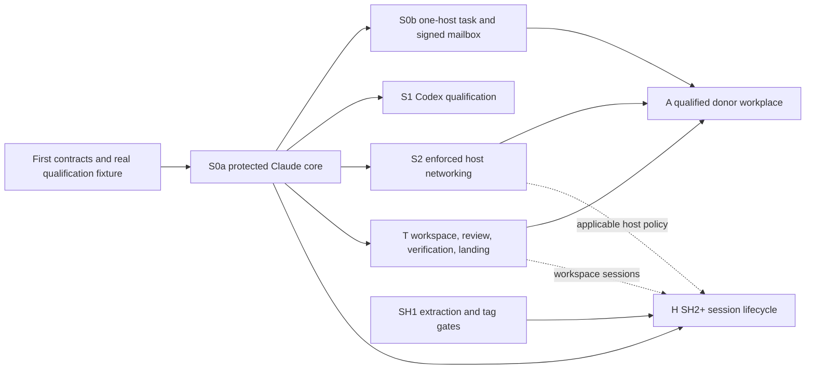

# Critical path and slices

Pen: astra-01. Review: astra-11, sol-01, sol-11; dependency, security, qualification and extraction lenses review the shared gates. Discussion: `s1-critical-path-slices` in `#swarma-impl-plan`.

Status: first draft for reconciliation, 2026-10-13. This is an implementation strategy, not implementation or qualification evidence. The S0a/S0b distinction and the relation between delivery order and parallel implementation require the cross-lens confirmations recorded below.

## 1. Start with a boundary that can be proved

The first useful implementation is one protected Claude launch across OS users, including its refusal and recovery paths. Implement the final dispatcher service and final executor boundary from the beginning. Do not first build a command-mode dispatcher, put a broker client in the board/session-host service, or create a disposable privileged executor to get a happy path running.

Three results must remain separate:

1. **SH1 compatibility extraction** proves that the existing board behavior survives a module move. It does not prove the new platform's isolation, authorization or recovery.
2. **The protected-launch core, S0a**, proves the broker/dispatcher/helper/executor boundary for an explicitly enrolled trusted local caller and one supported Claude tuple. It refuses untrusted placements and unpublished capabilities.
3. **The owner's one-host MVP, S0b**, completes the larger one-task chain named by CIP-0009: separate keeper/broker/worker identities, composed-plan caller/host integration, and a durable exact-byte signed mailbox. Neither result admits a donor workplace. The eventual external-admission milestone also needs enforced networking, the transfer/review/verification path, workplace ingress/stop semantics and a qualified donor tuple.

These labels are plan milestones, not new protocol versions. CB7 §16 defines the smaller broker slice; CIP-0009 §Implementation plan item 0 uses “slice 0” for the larger MVP. Making both visible prevents a passing broker demo from being reported as the owner's completed MVP. Conversely, the phrase “composed-plan host” does not, by itself, activate the full SH2+ backend or recursive orchestrator provisioning. Publish its minimum consumer seam explicitly. If that seam needs SH2+ behavior, the corresponding SH2+ gates become dependencies rather than being bypassed.

## 2. Work order and acceptance

Use separate code landings and activation decisions. Implementation behind a closed capability gate can proceed once its contracts and ownership are stable; activation needs the real deployment evidence. Every enabled slice retains all previously applicable refusal and recovery cases.

| Milestone | Scope and owner lanes | Prerequisites | Acceptance before claiming completion | Initial estimate |
|---|---|---|---|---|
| **P0: contracts and qualification foundations** | Joint broker, dispatcher, helper, launcher and operator owners freeze the first consumed canonical bytes, frame/intake contracts, durable effect/observation outcomes, generation/receipt identity and operator records. Infrastructure publishes the chosen lab host/runner matrix and evidence capture. Documentation owners fix the corresponding cycle-3 guidance. | Final source pins and named owners; explicit disposition of any decision needed by this milestone. Do not wait for every later remote/SH2 format to freeze. | The same versioned positive and negative vectors are consumed by both ends; mutant checks identify each security predicate; recovery outcomes are specified, not left to timeout interpretation. The first integration fixture names real sockets, descriptors, accounts and evidence, rather than only JSON validators. | M–L across several owners; first calibration point. |
| **S0a: protected Claude launch** | Root user manager/launcher v0; unprivileged dispatcher socket service; broker file store and software root under the separate operator boundary; approved narrow `curator-run` executor under the agent UID; operator and read-only observer. | P0 slice-0 contract set; approved provider tuple and enrollment; static range deny before account creation; qualified operator command/custody, current class/time/revocation evidence, mandatory refusal of untrusted placements. | Actual dispatcher creates, binds and launches; only the agent-side executor leases and injects the enrolled setup-token. Wrong peer/generation/account/profile, stale/revoked/expired authority, conflicting source, unavailable revocations, fenced restore, unsupported executor and inherited broker descriptor refuse. Real crash/replay/receipt/absence cases pass. Stops and recovery controls remain reachable while forward admission is closed. R-ALLSTOP includes never-launched generations and dispatcher-down partial completion. No launch credential file, argv/log disclosure, native credential fallback or Claude refresh. | L; integration-heavy despite one provider. |
| **S0b: owner's one-host MVP** | Minimal keeper registration/signing and signed mailbox/admission consumers, plus the composed-plan caller/host seam, joined to S0a. Operator-enrolled orchestrators are sufficient unless recursive bootstrap is explicitly added and qualified. | S0a; generation-bound keeper registration/detachment and any broker-key migration contract actually used; exact signed-intent replay, key-class verdicts and own-key signing boundary; versioned board/caller seam if a board task is claimed. | One admitted task traverses the required OS-user chain and returns a durable authenticated result. Wrong signer, scope, target, generation, expiry, changed intent under the same ID and stale replay refuse. Account retirement does not revoke a standing identity. Execution exit is not board completion. Claims about the MVP name exactly which host and mailbox operations were proved. | L; pending the minimum caller/host seam decision. |
| **S1: Codex protected provider lane** | Broker auth owner and launcher/runner external-token holder; selected supported app-server tuple; renewal, deadlines and teardown. | S0a; explicit C4 adoption/qualification disposition; published single-writer containment, attempt and vendor-store/outcome reconciliation; holder release/cleanup contract. | Real supported-release login/policy-fetch/401/slow-renewal/failure tests and every replacement/rotation case required by CB7 §9.6 pass on both required platforms. An orphan refresh writer cannot overlap replacement. Historical 0.155.x evidence is not a new supported-release pass. No broker-mode `codex exec`, launch `auth.json` or automatic alternate authentication. | L; provider behavior is a schedule risk. |
| **S2: enforced network and host admission** | Helper v1, network-profiles, proxy and infrastructure lanes implement per-generation listeners, machine-owned policy pins, service rows, resolver restrictions and per-host capability evidence. Watcher/ALLSTOP control contracts qualify with the selected enforcement. | S0a control/recovery foundation; frozen R-NETBIND/service-row/digest/zero-egress contracts; qualified actual host and provider tuples. S1-specific proxy routes additionally require that provider's evidence. | Static denial and precedence, own-port-only or workplace zero egress, every protocol/resolver/socket row, listener/service generation, policy drift and conservative budget recovery pass. Service replacements do not reset the identity's daily allowance. CONNECT authority/address confinement is stated accurately; opaque tunnels are not proof of application-origin isolation. Missing matrix rows or service readiness refuse. | L; evidence per OS/tuple, not parity by assertion. |
| **T: complete workspace-to-landing path** | Dispatcher/helper/launcher own materialize/work/export and cleanup; board owns deterministic import, candidate lineage, exact-candidate review and verdict; infrastructure owns verification and the selected non-agent external-effect performer. | S0a foundation and applicable qualified exec/host policy; published mode-aware manifest, exact-B/archive relation, transport/retention, cleanup authority and refusal disposition; positive review eligibility; qualified runner and repository/artifact transport. Workspace code may not run in agent accounts. | Exact B materializes; a stopped/fenced round exports without worker `.git`; result plus blobs survive home deletion; refusal/unknown retains the obligation. C is reconstructed and reviewed as inert data, with cumulative sensitive/provenance obligations through rework. Verification fetches without candidate execution, then executes offline using independently approved H. The effect performer rechecks authority and exact C at pending publication, artifact handoff and signed non-forced landing. Moved trunk requires the published refresh/review path. | L; several independent owners and one end-to-end acceptance chain. |
| **A: first remote workplace** | Remote bridge/join/registry and donor-A owners; dispatcher/workplace executor/helper; trust, networking, board and infrastructure lanes. Choose a named supported host/donor/harness tuple, not implied OS-wide support. | S0b, S2 and T; published join/package/signature-suite/backend contracts; chosen relay/ingress/execution lifetime; independent donor stop; operator admission; no shared-service colocation on the untrusted-work host. | Real join, signed task, first job, disconnect/reconnect, intermediate export, repair/rework, final export and retirement pass. In-flight SSH authentication cannot recreate a workplace process across quiet absence/export. P-256 A/C signatures survive unchanged through the selected receiver suite. Workplaces get no host credential lease, no local loop, no proxy destination and no undeclared socket. Every partial stop/recovery remains closed. Variant A's donor-side lack of isolation is explicit. | L; the first external-admission gate, not a reduced-privilege shortcut. |
| **H: qualified SH2+ hosted sessions** | Session host owns durable metadata, delivery and fences; agent runner owns PTY/private app-server and leases; dispatcher alone starts/stops through the root launcher. Board remains an optional adapter. | Stable extracted module or an explicitly approved integration plan from lens 3; S0a and supported provider lanes; joint R-SESSION/state/receipt/capability contracts; storage reserves/retention; applicable S2 and T gates. The reboot requester is selected before automatic reboot recovery. | Initial start, park, authorized successor, crash/replacement, unknown delivery, maintenance and reboot scenarios preserve current epochs and account-wide absence. Fresh runner separately checks native lock. Unknown delivery remains fenced; no old receipt/approval authorizes a new effect. Sustained output cannot consume another session's control reserve. Goal-free operation works; caller/board goal authorship stays distinct. Standing lifetime remains unbounded while each successor still requires its admitted consent and current authority. | L–XL; SH7's existing estimate is 45–100 clean or 150–300 rework landing-hours, not a new measurement. |

Estimate convention: M is a bounded contract/consumer integration; L spans several process or repository boundaries and adversarial recovery; XL adds a durable service lifecycle and multiple consumers. These are ordering estimates, not elapsed-time promises. The cited SH2+ figures are the source plan's estimates. Calibrate calendar and token forecasts after P0's first real integration gate and the SH1 F gate; include review, CI queues, provider/host access and rework. Do not multiply a single agent's throughput by the number of seats.

### S0a is not a happy-path exception

CB7 §16 explicitly includes retained bind/unbind observations, R-OUTCOME, R-REBIND, fenced restore/start, R-TIME watermark and elapsed-removal rules, `effect.observe`, `revocation.check`, and journaled ALLSTOP with explicit recovery. These remain in S0a. Channel-specific lease cleanup must also be published before activation: successful env exec leaves no surviving broker client. A process start receipt proves the privilege boundary, not harness initialization or token cleanup.

Prefer a deliberately non-workspace one-shot for the first proof, but **publish its admissible intake first**. LR6 §10.1:1757–1765 currently says the composed plan MUST carry a workspace section; the legitimate non-workspace cleanup case does not supply a missing input variant. The launcher/dispatcher/helper owners must specify a narrow non-workspace case without guessed null fields or bypassed checks. It must create no R-TRANSFER export obligation and make no claim about delivering code. Otherwise T's workspace lifecycle is a prerequisite of the first admitted launch. A coding task, or any allocation carrying that obligation, waits for T; naming its data “scratch” cannot waive export before deletion. Fixed read-only resources and an approved minimal exec profile avoid prematurely qualifying general interpreters, not the need to qualify the admitted invocation.

Publish which watcher capabilities v0 actually ships, including journaled stop/hold behavior and status visibility. Do not advertise per-account egress freeze before its v1 enforcement exists. A qualified status-only notification stage is permissible only when explicitly documented; the observer path and containment remain required within their stated scope.

## 3. The critical path and parallel work

The graph shows technical prerequisites, not authority to reorder an adopted release sequence. CB7 §16 lists Claude, Codex, then enforced networking. Implement S1 and S2 behind their gates in parallel once their shared contracts stabilize; do not silently claim an earlier S2 release or weaken S1's both-platform gate. If C4 blocks S1 and an earlier qualified S2 release would unblock the external milestone, obtain an explicit contract/owner disposition of that scheduling change. A's functional prerequisite is qualified enforcement, not an invented dependency on Codex personal-plan credentials when its chosen donor tuple uses Claude.

The longest path to the owner's goal is likely the maximum of (a) first-slice authority/recovery plus the minimal one-host task path, (b) enforced host qualification, and (c) end-to-end transfer/verification/transport, followed by workplace integration and the real donor scenario. This is a hypothesis to measure at P0, not a schedule derived from document length. The workplace ingress lifetime, exporter disposition and effect-performer choices should be resolved early because they change several consumers.

Parallel lanes that can produce reusable work now:

- **SH1:** F proves the real graph before neutral seams are frozen; O pins/copies the accepted snapshot; only disjoint frozen G/X work runs in parallel, then Y/Z and tag-consumer evidence. The existing board runtime continues until C1. SH7 fixes C1 no earlier than 19 October and requires quiescence and schema-safe rollback. Do not make S0a depend on that production cutover merely to reuse the launcher library.
- **Contracts and adversarial vectors:** producer and consumer owners co-author each consumed format; shared grant/revocation verifier and bounded effect/recovery rules precede their clients. Later remote and SH2 contracts can be developed concurrently without delaying a fully specified smaller slice.
- **Host evidence:** disposable Linux and hosted macOS qualification can proceed without touching the overloaded operator runtime. Prefer the first host whose complete matrix can be proved; the OVH Linux candidate is a scheduling candidate, not an OS exemption or an automatic admission. R-SHARED rules out external work beside the current shared services.
- **Transfer and verification:** implement the board's inert import/review path, negative corpus and offline verification pool while the protected execution stack is assembled. Fixtures prove parser behavior; only the later real cross-account path discharges T.
- **Provider research:** honor the decided Muse C7 priority in a separate qualification lane using the required dedicated test account. Its proposed channel, billing and refresh semantics stay unqualified; it does not replace S0a's selected Claude channel. Codex historical evidence is likewise not activation.
- **Documentation alignment:** fix trust/book/figure propagation and the owner-linked rule/format index with the relevant contract landings. Keep consumer-specific gates local; “draft published” never means “implemented and qualified.”

## 4. Cycle-3 finding placement

This table covers all 44 confirmed input files present when this draft was written. It allocates the earliest relevant correction and the activation it blocks; other sections own detailed remedies. A finding can be satisfied by a published bounded disposition when it explicitly offers alternatives. The plan does not silently select new owner policy. Curator numbering/merging may change presentation; preserve every slug and acceptance case.

| Finding(s) | Fix before / blocked claim |
|---|---|
| `f-allstop-dispatcher-path`, `f-allstop-unstarted-generation` | P0 stop/act/receiver-frontier contract and S0a qualification. Preserve both dispatcher-down partial completion and healthy never-launched cases even under one final finding number. Requalify workplace ingress at A and host fences at H. |
| `f-exec-profile-authority`, `f-exec-input-closure` | P0 protected selector/digest and complete invocation qualification; before any slice enables the relevant tool profile. S0a can choose a minimal qualified profile; T/A cannot infer input inertness from a path allowlist. |
| `f-host-credential-lookup`, `f-book-env-report-client` | Correct first-consumer and env-holder lifetime guidance before S0a acceptance; retain the later external-token distinction for S1/H. |
| `f-r-name-namespace`, `f-wire-register-drift` | P0 owner-linked index and relevant current names/statuses before consumers freeze; later rows remain capability-gated. Removed tickets are not pending work. |
| `f-keeper-identity-generation`, `f-grant-figure-vocabulary`, `f-mailbox-figure-verdicts`, `f-envelope-intent-replay` | Before S0b's keeper/signed-mailbox consumers. Preserve kernel-peer own-key signing and full signed-intent conflict checks. Any H consumer inherits those contracts. |
| `f-delegated-action-envelope` | Freeze the registered-effect route before enabling that capability. It is not required to add generic delegated host actions to the first ordinary mailbox. No peer-data elevation as a shortcut. |
| `f-ledger-topology-read` | Publish reader/phase and observable-metadata policy early, before child-view enforcement; implement/qualify the selected policy before A. Do not promise total topology secrecy or apply a blind deny that breaks legitimate readers. |
| `f-trusted-circle-class` | Positive admission/review predicates before T/A/H consumers. Separate local-only-reviewer/requester-exclusion proposals remain owner decisions; circle opt-in itself grants no host loop, lease or review role. |
| `f-connect-origin-boundary`, `f-dial-guard-transition-ranges`, `f-proxy-budget-incarnation` | S2 provider-proxy assurance and guard/accounting qualification; also T's N16 dependency proxy. Restore/replacement/clock cases are part of the gate. |
| `f-watch-freeze-lifecycle`, `f-alert-egress-owner` | Publish v0 availability, journaled stop/hold and notification disposition in P0/S0a; qualify the applicable capability before shipping it, and v1 enforcement by S2/A. Early status-only operation must be explicit and authenticated; alerts never delay containment or acquire mutation authority. |
| `f-workspace-result-modes`, `f-base-binding` | T contract freeze before exporter/import code locks onto a manifest. Mode/type-only edits, deletion prior mode and independent repository-B recomputation qualify together. |
| `f-export-cleanup-authority`, `f-export-refusal-pins` | T before first workspace-capable allocation. Cleanup authorization, complete artifact durability, deterministic refusal/permission failure, bounded repair and retained obligations are separate cases. Standing automatic discard remains an owner choice. |
| `f-review-harness-surface`, `f-rework-inherited-flags` | T before first candidate review/acceptance. Start with exact-C diffs/blobs outside native discovery roots; full strict-context adapters only when a workflow needs entry into candidate trees. Fresh cumulative acknowledgements apply through rework. |
| `f-verify-network-phase`, `f-landing-egress-principal` | T before verification or repository/artifact external effects. Choose a qualified non-agent performer; no compulsory new daemon or revived board server. N16 offline execution is an OS boundary, not `GOPROXY=off`. |
| `f-workplace-relay-quiescence`, `f-donor-signature-algorithm` | A contract freeze and end-to-end qualification. Ingress closure and the selected worker signing suite are first-donor prerequisites, not later hardening. |
| `f-donor-egress-principals`, `f-donor-provisioner-register` | Correct the boundary/status before remote documentation is used; concrete principal/control/refresh routes and separate provisioner gate block B. Do not add donor verbs to the project helper. A still keeps its own credential/channel requirements. |
| `f-host-output-accounting`, `f-restart-stop-authority`, `f-resume-probe-superseded`, `f-book-reboot-requester`, `f-agent-goal-authority`, `f-unknown-data-replay` | H contracts and qualification before corresponding features; repair stale guidance with those contracts. No new resume-version probe, agent self-goal capability, launch ticket, automatic unknown-data replay or default reboot requester. SH1 preserves compatibility rather than claiming these target semantics. |
| `f-book-archive-tree` | Align F-1 deletion/metadata guidance before S0a retirement documentation is accepted. No home archive reinstatement. |
| `f-book-egress-example` | Align static-v0 versus enforced-v1 and provider destination claims before S0a/S2 documentation is accepted; no code-hosting exception in an agent profile. |
| `f-book-one-shot-export` | T, before the first workspace one-shot; keep legitimate non-workspace S0a cleanup distinct. |
| `f-book-cip-figure-copies` | Refresh with A/T contract landings, including verification mediation and render policy; name the landing owner responsible for source-pin freshness. |
| `f-book-web-boundary` | Correct before A documentation; optional web stays default-off and cannot block a web-free first donor. A future opt-in also needs separate web custody and qualification. |
| `f-book-muse-c7` | Correct decision/proposal/qualification states in P0/provider research planning; priority is decided, the channel is proposed, evidence remains open. |

The withdrawn `f-provision-activation-order` is not an additional gate. Its valid checklist remains inside R-NETBIND qualification: enforce before active, keep pending create inactive/rollback-safe, and retain policy pin/revalidation. Likewise, credential rebind does not grant a fresh session permit; no separate session-renewal finding is resurrected.

## 5. Avoid wasted work and stop conditions

- Keep one dispatcher service and one launch verification library. Add capability gates to the final transport, not command-to-daemon migration or two parallel runtimes.
- Keep the first admitted task/tool/provider tuple narrow. Do not generalize authentication nodes, provider graphs, arbitrary interpreter profiles, context adapters or donor variants before a concrete consumer requires them.
- Keep operator-mediated or existing trusted artifact/landing infrastructure as a permissible initial choice if its full authority/evidence boundary qualifies. Automation is a later optimization; unsafe agent-side push is not an interim lane.
- Never trade a missing contract for guessed fields. Named owner, closed intake, replay semantics and real refusal evidence are needed before activation; dead code behind an explicit gate is different from an enabled speculative API.
- If F cannot prove the extraction seam, stop SH1 at mechanical compatibility and leave the board dependencies in place. If the first protected tuple cannot prove peer/credential/process boundaries, stop S0a rather than add fallback. If a host row cannot be qualified, refuse that placement. If ingress/export evidence is unknown, retain the account and stop the external milestone. None of these outcomes authorizes deleting evidence or weakening the invariant.

## 6. Evidence and reconciliation register

Primary pins: dispatcher DP7 `74687e60` §§2, 5, 7–9, 11–16; broker CB7 `df8c7385` §§3.1, 9.6, 15–18; helper UM7 `7b59da74` §§4.3–4.7, 7–8, 12–14; launcher LR6 `f08f566d` §10; session host SH7 `798a321c` §§1–4, 7; curator-spec `a0154285`, CIP-0009 implementation items 0–6, CIP-0010 C7, platform-contract-disposition and Decision 0021 as superseded by the current module decisions; N15/N16 `359365e`; board transfer draft r6 `d65cf7f`; review corpus `83bde54`.

Open cross-lens reconciliation:

1. S0a/S0b distinction and the minimum composed-plan caller/host/keeper/mailbox consumer, requested in event `$44qCWLadl-OsgjI2zgecOtB_cdt9RjWBXqFGHlhCWrs`.
2. Preserve the published S0/S1/S2 release order while allowing implementation concurrency; any proposed S2-before-S1 activation needs an explicit disposition rather than a diagram implication.
3. Reconcile H's extraction/tag prerequisite and independence of S0a from the production C1 calendar with lens 3.
4. Use lens 2's final contract packets, lens 4's measurable qualification rows, lens 5's operator/eligibility decisions and lens 6's host cutover gates as the detailed owners. Core astra owns the assembled schedule; no competing `PLAN.md` is written here.
