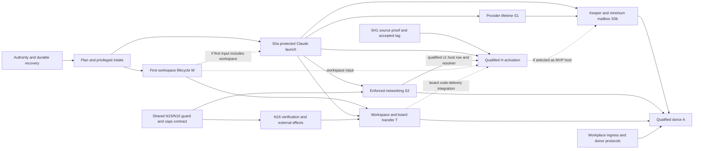

# Dependency graph and contract freezing

- **Pen:** astra-10. **Review:** astra-02, astra-12, astra-20, wonder-03 and wonder-13. Discussion: `s2-dependency-contract-freezing` in `#swarma-impl-plan`.
- **Status:** section draft for reconciliation, 2026-10-13. Publication requirements below are work to do, not assertions that a format is frozen, implemented or qualified.
- **Inputs:** accepted F-1–F-28, with F-26 withdrawn; all 44 confirmed cycle-3 finding files. Their remedies remain planning inputs, with separately identified owner choices preserved. Milestone labels follow [critical-path-slices.md](critical-path-slices.md): P0, S0a, S0b, S1, S2, T, A and H.

## 1. Freeze the next consumer, including its failure path

The first contract freeze is the protected launch and recovery boundary. Do not wait for every remote or SH2 format. Conversely, a schema for successful launch alone is insufficient: the first consumer needs its original-caller identity, immutable arguments, durable observations, cancellation, absence, time, restore and cleanup contract before it can be enabled.

Keep five facts separate in each existing publication register; these are evidence facts, not a new runtime state machine:

1. **Decided semantics:** the owner has selected the authority or invariant. This does not publish an encoding.
2. **Published draft:** readers can inspect concrete fields or canonical bytes. A draft may still change and may omit the surrounding lifecycle.
3. **Frozen producer/consumer contract:** both owners accept a pinned revision, shared positive/negative vectors, compatibility rules and the required failure/recovery behavior for a named consumer.
4. **Implementation availability:** name the actual released artifact and supported feature, including whether the capability remains closed. Publication and a frozen contract do not imply that executable code exists.
5. **Qualified activation:** that consumer's actual accounts, sockets, executables, OS/backend and storage satisfy the required evidence. Parser agreement, a released artifact and a successful model do not establish this fact.

For example, DP7 publishes DRAFT `swarma-dispatcher workspace-result/1`; it does not publish the complete archive, manifest, intake, transport, retention or cleanup contract. R-START already removes launch tickets; a stale register must not turn them into future work. Muse C7 priority is decided while the proposed subscription channel and its qualification remain open. These distinctions belong beside the authoritative owner reference, not in a new central service or independent normative schema catalogue.

Resolve naming scope before golden bytes, not by blanket prefixing. CB7 `:46` explicitly separates prefixed signed domains from short `grant/1`, `revocation/1` body discriminators and `broker/1`; DP7 `:120` likewise preserves its transport/schema labels. Clarify the common rule's scope and pin producer/consumer agreement. R-LR1 already routes to Decision 0021 and launcher §10; an incomplete audit index is not an absent intake owner. The remote register's unresolved wire ownership concerns the two channel/backend shorthands, not the bridge's already assigned join objects.

The contract packet for a consumer contains: owner and source revision; exact signature domain and canonical bytes where applicable; closed request/result/error grammar and bounds; authenticated actor and generation; idempotency key versus full-intent comparison; outcome and absence semantics; durable record/retention/restore ordering; time and cancellation behavior; positive, negative, mutation and crash cases; and the explicit disabled capabilities. Name both producing and consuming maintainers. Freeze protocol-dependent implementation against that packet; independent host research, fixtures and source-derived SH1 work can proceed beforehand without being called interoperable production code.

## 2. Ordered contract packets

These are planning groups, not new wire objects or components. One group may land in several repositories, but it has one agreed dependency and evidence set. A group is not frozen while one receiver still depends on an unspecified authority or outcome.

| Packet and earliest consumer | Freeze together | Owning lanes and dependency |
|---|---|---|
| **Authority and core recovery — P0/S0a** | Existing `grant/1`, `revocation/1`, `broker/1` canonical definitions and verifier vectors; `dispatch/1` socket admission/caller signatures; R-OPERATOR command-only entry, signed act domains, confirmation/replay, observer reads and key recovery; class evidence/refusals; R-VERDICT and R-OBS encodings; receiver R-OUTCOME tables; retention/admission floors; R-GEN restore fencing, R-TIME watermarks/elapsed evidence, R-REBIND and R-LOCK in-flight/late-result rules. ALLSTOP includes per-service durable holds, dispatcher-down progress and never-launched generations. | Broker, dispatcher, user manager, operator/installer. Reuse the existing broker domains; phone records do not silently change broker signatures. This is first-slice work, not an operations appendix added after launch. |
| **Plan and privileged intake — P0/S0a** | R-LR1 selected opaque exact-byte envelope or closed plan schema, admitted digest/framing and final-exec source binding; approved executor invocation; one user-manager-owned R-FD3 lifecycle with bounded immutable staging, handle closure, UID/GID transition and failure cleanup; immutable launch/stop claims and root receipts; machine-owned exec-policy selection and resolved digest; the actual minimal tool invocation and its interpreted-input closure. Select the env lease cleanup model and pre-exec refusal handling. | Launcher + user manager + dispatcher + broker. Depends on core identity/effect semantics. Exec-policy selection can use the existing protected machine-policy owner before full N15 v1 enforcement is ready. No arbitrary caller argv, second FD lifecycle, inherited broker descriptor or surviving post-exec env client. |
| **Keeper and minimum signed mailbox — before S0b** | Generation-bound registration, one-shot designation, active-ledger checks, detach-before-reuse, separate identity revocation, and any broker-root migration actually used. Name the minimum composed-plan caller/host and mailbox consumers; freeze signed content, admitted key classes, own-key signing, complete-intent replay comparison, durable acknowledgement/recovery and output/evidence accounting for their active operations. | Keeper/trust + caller/bridge + dispatcher/broker; core identity/recovery, S0a and qualified S1 Codex. The recorded one-host MVP requires Claude AND Codex, without the board or remote harness (wiki :535); historical CIP F25 is not review finding F-25. A composed-plan host does not itself activate SH2; if the chosen consumer needs SH2 behavior, its corresponding gates become dependencies. Generic registered host actions stay disabled until their distinct constructible envelope/receiver route is published. |
| **Provider lifetime — S1, with Muse research separate** | Supported Codex tuple and C4 disposition; single auth-owner and all-writer containment across replacement; attempt identity, vendor-store/outcome reconciliation, renewal deadline/final material checks; surviving external-token holder, private app-server and teardown/release. Muse C7 gets its own evidence-backed channel decision and qualification packet. | Broker + launcher/harness + qualification. S1 builds on S0a. Historical provider evidence is not current support. Neither provider research nor later stdin lifetime choices delay a fully specified Claude env consumer. Preserve CB7's required both-platform replacement/rotation gate. |
| **Live-provider lab — before real S0a/S1 qualification** | Separately publish and authorize the selected platform/vendor artifacts, host/account ownership, enrollment ceremony and custody, containment/network, bounded/redacted evidence export and teardown/revocation. Identify any necessary exception to the general secret-free test-runner rule before execution. | Provider + qualification + security + operations. Candidate and synthetic/mutation R-VERIFY stays secret-free. Exact-C acceptance does not admit ordinary candidate tests to a credential-bearing lane. CB7 §9.5 excludes same-account cross-host use without a separate ownership design, even with serial ceremonies; distinct dedicated accounts per independent host owner are the smaller initial proposal. This plan neither provisions nor authorizes a live lab. |
| **Enforced network and containment — S2; shared N16 parts before T verification** | R-NETBIND name/lock-to-policy mapping and immutable pins; N15 listener/account/service generation and served-policy digest relation; own-port/zero-egress and service rows; resolver/socket and range-precedence evidence; `fw.apply`/`fw.remove` outcomes; kernel plus proxy-session reapply; complete dial guard and precise CONNECT assurance; usage-budget continuity across replacement/time changes; watcher freeze precedence, release, telemetry provenance and version. | Network profiles/proxy + user manager + dispatcher + broker + infrastructure. Reuses core identity/effects. Static R-RANGE-DENY and its active probes begin at v0; they are not postponed to S2. Full per-account freeze is a v1 capability. Publish the v0 stop/hold and notification disposition; alert delivery never gates containment. |
| **Workspace and result custody — first workspace allocation, W** | One canonical B manifest with path/kind/mode/content identity and archive verification, agreed with the later board consumer; exact plan scope/resource/exec/cap pins; materialize/work/export execution linkage; workspace fence and account-wide absence; DRAFT result plus blob/digest rules; cleanup authority after ordinary expiry and security-hold behavior; complete-content durability/retention and authenticated release; refusal, infrastructure failure and any exposed bounded current-authority repair. | Dispatcher + helper + launcher + transfer, with board agreement on shared representations. Depends on core launch/effects and applicable tool/host qualification, not automatically on a donor or completed S0a/T milestone. Exporter identity differs from the worker execution being exported. No worker `.git`, elevated exporter, implied waiver or retained-content expiry before authorized disposition. Independent complete-content custody can permit retirement before import. |
| **Candidate import and review — T** | Independent board manifest recomputation from immutable repository B; deterministic import and candidate identity; trusted integration review baseline; cumulative sensitive/provenance obligations, positive reviewer eligibility, inert exact-C review and candidate-bound verdicts; new C-based rework intake and fresh acknowledgements. | Board/transfer + dispatcher/workspace + review/harness. Consumes W's frozen representation, but its full implementation is not a prerequisite of merely retaining exported content safely. Review, verification and landing cannot be claimed from W. |
| **Verification and external effects — T** | Approved H and candidate C/B/artifact bindings; inert dependency fetch followed by offline execution, including vendored jobs; secret-free off-host job/result contract. Select the non-agent performer for pending-ref publication, bundle handoff, base refresh and landing; publish its authenticated invocation, credential/signing custody, result path and effect-time checks. | Board + infrastructure + repository/runner transport, with N16 and trust owners. Local import and local fast-forward remain possible. A qualified existing, off-host or explicitly operator-mediated performer is a valid candidate; a new daemon is not prescribed. Only a performer on the enforced host needs its own local service row. Private/tailnet runner ingress cannot be assumed reachable through N15's public-destination guard. |
| **Workplace and donor A — before A** | Select relay/backend lifetime with generation-bound ingress-creation fencing, asynchronous handoff or another explicitly authenticated arrangement; reconcile starts, every UID process, reconnect, export, watcher/ALLSTOP, permanent retirement and reopening. Publish the remote channel/backend wire owner, claims/floors/observations separately from output-cache retention, join/invitation/package schemas, DNSSEC/trust mode, admitted worker signing suites and exact-byte final-envelope verification. | Remote bridge/executor + helper/dispatcher + trust/join + board. Activation requires S0b, S2 and T, plus the selected host/donor tuple. P-256 donor signing must compose with every receiver; it does not change the broker/operator root format. Donor B's separate provisioner and principal/refresh/control routes are later gates, never project-helper extensions. |
| **Hosted sessions — before H and each optional consumer** | Owner lifecycle authorization, session-scoped permit, distinct per-start claims, `host_start`/`host_stop`, withdrawal/cancel/crash ordering, current-epoch runner channel, process fate, receipt/application evidence and durable storage budgets/reserve. At the service-UID move, replace direct notice/context file APIs with authenticated calls and introduce agent-account runners together. Select reboot requester before that path; retain D-RESUME, native-lock and surface checks. Freeze standing/team, recursive delegation, optional goal-client, nudge and adapter contracts only before enabling their respective consumers. | Session host + dispatcher + helper/launcher + broker + optional board adapter. Stable extracted-module and core/provider contracts plus verified v1 host deny-all row, parent anchor and resolver evidence are mandatory, including goal-free H (SH7 :136/:140). Workspace packets are conditional on actual workspace use. Host service never receives credential material. Goal-free sessions do not depend on self-goals; unchanged SH1 compatibility does not prove new SH2 semantics. |

The source anchors are CB7 §§16 and 18; DP7 §§14 and 16; UM7 §14; LR6 §10.1; SH7 §7; CIP-0009 implementation items 0–6 and the remote-worker publication register. Each explicitly distinguishes already selected ownership from pending encodings and activation. The table incorporates the confirmed cycle-3 constraints rather than treating an old open-question list as the final frozen contract.

## 3. Critical edges and apparent cycles

This is a technical dependency graph, not a change to the adopted S0/S1/S2 release order. S1 and S2 publication/implementation can proceed in parallel after shared contracts stabilize. An earlier S2 release while C4 remains blocked requires the explicit disposition identified by lens 1; a graph must not silently authorize it. S1 is a completion dependency of the recorded Claude-and-Codex MVP. Every target H consumes the qualified v1 host row/resolver contract. Workspace-bearing H needs W's complete lifecycle/custody; full T applies only before the actual board code-delivery integration or claim, and remains required for A. H is a dependency of S0b only if it is the selected MVP host. The board remains optional for generic hosted sessions, including that selected board-free MVP consumer (SH7 §3.8).

**Resolve the first-plan branch explicitly.** LR6 `SPEC.md:1757–1765` currently requires a workspace section in the composed plan. A non-workspace protected proof is the smaller first consumer only after launcher/dispatcher/helper/broker owners publish an admissible intake case. Do not guess null members or rename a coding workspace “scratch.” If that contract is not selected and published, W's materialize/stop/fence/distinct-execution/cleanup/refusal/durable-result-custody subset is part of S0a acceptance. Full T later adds board import, candidate-wide review, verification and external effects; S0a need not wait for landed code merely to retain a complete export safely. The graph therefore does not require S0a → complete T → S0a. A first workspace may be trusted and local; remote-A timing cannot excuse missing export/cleanup.

**Operator bootstrap is installation, not an agent task.** The authenticated installer provisions the protected operator and observer accounts, then pins UIDs and authority before agent admission (UM7 §§2–3, 4.3, 11). This breaks the apparent dependency on an already running agent or keeper. Phone-signed records, authenticated non-cached helper transition, terminal fallback and read entry points still need their joint contract. A working terminal fallback is not permission to invent a phone-to-sudo route or waive the published first-slice custody gate.

**An obligation is not authority.** Export cleanup needs its own bounded admitted authority after work expiry; repair starts work and requires current work authority. R-SESSION authorizes the admitted runner/plan, not a different exporter. A watcher freeze release is not restart authority. ALLSTOP recovery is not an implicit release of every retained claim. These distinctions prevent receiver implementations from closing gaps with broad operator privileges or new unreviewed calls.

Optional service-generated retirement metadata export is another distinct consumer. Its schema may stay disabled while ordinary retirement quiesces, destroys declared keys and deletes the home. This does not waive an R-TRANSFER workspace obligation. Similarly, the initial authenticated dispatcher sudo/role path is not helper-v2 signed-grant verification; no helper-v2 verifier or new `effect.release` is a core prerequisite. Keep process/generation ownership locks distinct from state-transition locks.

**Freeze one physical lifetime across a boundary.** The workplace relay cannot be ignored when launch requires zero UID processes. Select ingress, job/runner, stop, export and reconnect together before independently implementing the two ends. Keep D7's permanent certificate/channel revocation, but do not substitute permanent retirement for a reusable round transition. For ALLSTOP, independent receiver progress while the dispatcher is down does not establish the dispatcher's own hold/journal acknowledgement or whole-act completion.

**Do not serialize unrelated work.** SH1's F/source-freeze/seam/tag proof runs alongside platform packets; its production C1 cutover remains no earlier than October 19 and requires the separate maintenance gates. No S0a credential boundary depends on that production cutover merely to reuse the launch library. Inert exact-C diffs/blobs outside discovery roots avoid a full CIP-0002 rollout for first review; entering a candidate checkout requires the qualified strict adapter. Default-off web, donor B/C, general delegated commands, user-manager v2 signatures, seamless credential handoff and self-goals remain outside earlier consumer contracts.

## 4. Finding coverage and freeze deadlines

This is the lens-2 dependency disposition for all 44 input slugs, not a second acceptance ledger. The assembler retains each slug and distinct qualification case even if documentation edits or final numbering are consolidated. Fix propagation in the same landing as the owning contract, before dependent implementers freeze against the stale example. A book edit alone does not discharge a runtime publication gate.

| Input finding(s) | Contract deadline and blocked consumer |
|---|---|
| `f-wire-register-drift`, `f-r-name-namespace` | P0 owner-linked register/index repair. Classify actual wire identifiers, design labels, component names, normative rules and qualifications separately; route each to its existing owner. Recheck affected rows at every later freeze. |
| `f-allstop-dispatcher-path`, `f-allstop-unstarted-generation` | Core recovery before S0a. Preserve separate dispatcher-down and never-launched-generation vectors; later workplace ingress and host delivery extend the same whole-act accounting. |
| `f-exec-profile-authority`, `f-exec-input-closure` | Core plan before first task-tool admission. Protected selector and immutable digest do not prove interpreted-input inertness; qualification covers the complete admitted invocation. |
| `f-host-credential-lookup`, `f-book-env-report-client` | Before S0a's first credential consumer; retain S1/H holder distinctions. Correct stale host-UID lookup and impossible env post-exec reports without adding a reporter. |
| `f-keeper-identity-generation`, `f-grant-figure-vocabulary`, `f-mailbox-figure-verdicts`, `f-envelope-intent-replay` | Before S0b keeper/mailbox consumers: generation, own-key signing, registered action vocabulary, key-class verdict and complete signed-intent comparison. An exact retry returns its original receipt; changed intent conflicts under the existing ID key. |
| `f-delegated-action-envelope` | Before any registered delegated-effect consumer. Ordinary peer data remains non-authoritative; a minimal mailbox does not require generic host actions. |
| `f-connect-origin-boundary`, `f-dial-guard-transition-ranges`, `f-proxy-budget-incarnation` | Before S2 provider proxies and T's reused N16 guard/caps. Freeze precise opaque-tunnel assurance, complete exclusions, budget identity/window and conservative replacement recovery. |
| `f-watch-freeze-lifecycle`, `f-alert-egress-owner` | Publish v0 availability and status-only or qualified notification disposition before S0a claims; freeze full per-account containment before S2/A. Alert transport remains independently gated and cannot delay narrowing. |
| `f-workspace-result-modes`, `f-base-binding`, `f-export-cleanup-authority`, `f-export-refusal-pins` | Before first workspace allocation, at T or earlier if the S0a intake requires it. Freeze mode-aware B, archive verification, durable complete-content export, consent/capacity/security holds, refusal/failure and current-authority repair. Standing automatic discard remains an owner choice. |
| `f-review-harness-surface`, `f-rework-inherited-flags`, `f-trusted-circle-class` | Before T review/acceptance and any affected placement: inert candidate consumption, trusted integration baseline, cumulative obligations and explicit positive eligibility. Circle membership alone does not grant review or a local loop. New local-only-reviewer/requester-exclusion policies remain owner choices. |
| `f-verify-network-phase`, `f-landing-egress-principal` | Before T executes candidates or performs external effects. Freeze fetch/offline execution and C/B/H-bound evidence; select and authenticate the actual non-agent effect performer before transport code depends on its topology. |
| `f-workplace-relay-quiescence`, `f-donor-signature-algorithm` | Before A backend/enrollment/final-envelope freeze and qualification. Neither a standing runner nor a package listing P-256 resolves these consumer boundaries. |
| `f-donor-egress-principals`, `f-donor-provisioner-register` | Repair donor ownership/status guidance before use; freeze concrete B routes and its separate provisioner before B implementation/activation. Do not add donor verbs to user manager. |
| `f-ledger-topology-read` | Publish legitimate readers/phases and selected metadata-visibility policy before implementing child-view restrictions; qualify that chosen boundary before A. Optional hardening does not establish total topology secrecy. |
| `f-host-output-accounting` | Before the first durable service-output consumer, including S0b if its selected seam retains such output; H necessarily consumes it. Retained-byte debt, bounded buffers/refusals and the control/evidence reserve cannot be postponed by a milestone label. |
| `f-restart-stop-authority`, `f-resume-probe-superseded`, `f-book-reboot-requester`, `f-agent-goal-authority` | H and its corresponding optional lifecycle/goal consumers, or an earlier S0b seam actually consuming those behaviors. Stop ownership, resume compatibility, reboot requester and goal authority are separate decisions. Do not add SH2 behavior to SH1 as a propagation fix. |
| `f-unknown-data-replay` | Repair SPA-local policy drift before H/new receipt-recovery consumption; apply the settled unresolved-evidence rule wherever the S0b mailbox consumes it. Do not infer that the older exception is valid merely because the consumer predates H. Positive non-application and unresolved application remain distinct. |
| `f-book-archive-tree`, `f-book-egress-example` | Before S0a retirement/network guidance is accepted; preserve metadata-only export and the difference between static v0 baseline and per-account v1 enforcement. |
| `f-book-one-shot-export` | Before the first workspace-capable one-shot's cleanup contract, including W within S0a/S0b if that branch is selected. Its local scope must not wait for complete T or donor A. |
| `f-book-cip-figure-copies` | With the corresponding T/A contract landings before those flows are used. Include mediation, actual source revision and a declared render policy; local-copy agreement alone cannot detect upstream drift. A first local one-shot does not require every remote figure. |
| `f-book-web-boundary`, `f-book-muse-c7` | Repair status/custody now with the relevant references. Web-free A and Claude S0a do not wait for those optional channels; later activation retains separate opt-in/custody or provider qualification. |

The withdrawn provisioning-order candidate is not a new state or gate. Preserve pre-active enforcement and pending-create rollback in the existing R-NETBIND contract; a later same-pin reapply is legitimate. Names removed by owner decisions, including launch tickets and generic donor-helper verbs, are not publication backlog.

## 5. Freeze discipline, parallel work and estimates

Use the existing repository owners and reviewer lanes. First agree the cross-boundary semantic decisions and failure cases, then publish exact consumer bytes and vectors, then implement both ends against the pin. A consumer-affecting revision updates its producer/consumer matrix and shared vectors in one coordinated landing sequence; keep the affected feature closed until both revisions are available. Do not migrate a format that has never shipped merely because its draft name changed. For deployed state, define permitted reader/writer pairs and evidence-preserving rollback before changing it.

A practical publication order is core authority/recovery and protected intake together; then independent provider, keeper/mailbox and enforcement packets; then workspace/board/runner and remote ingress/enrollment packets converging on A; H proceeds on its own selected extracted-module and platform dependencies. Workspace may move into the first group if the intake remains mandatory-workspace. Resolve that branch before assigning implementation work, not after a happy-path demo.

Bound the initial scope: one explicit trusted caller class, one admitted Claude tuple, one minimal tool profile, one exact-C data-only review presentation, one chosen artifact performer and one remote backend. Do not implement every proposed alternative. Keep reusable primitives such as canonical verification, effect observations and guard conformance vectors shared; component-specific signed domains, privileges and receiver outcomes remain explicit.

Effort is **M** for a bounded two-owner format packet with agreed semantics, **L** for the core recovery/operator packet, transfer custody and workplace lifetime because they require several owners and crash ordering. These are relative planning classes, not fresh measured hours. Unresolved topology/policy choices invalidate a precise implementation estimate. Re-estimate after the first producer/consumer vector set and real boundary fixture, including review, provider access and runner latency. Publication work and independent fixture preparation can overlap; two implementations racing an unfrozen interface are not useful parallelism.

Stop the affected packet if owners cannot identify the authority, complete observation/retention semantics or first consumer; if canonical vectors disagree; or if a proposed simplification creates a new privileged path. Preserve the disabled capability and continue independent work. Owner choices that cannot be silently normalized include C4 adoption, soft-ceiling acceptance, any class reinterpretation or new reviewer policy, standing refusal-discard authority, remote wire ownership, and selection of a still-open reboot requester. Ordinary byte/mechanism choices are joint lane publication work unless their source explicitly requires the owner's decision.

## Evidence and review record

Pinned primary corpus: broker CB7 `df8c7385` §§3.1, 8.5, 16, 18; dispatcher DP7 `74687e60` §§14, 16; user manager UM7 `7b59da74` §§2–4, 7–8, 14; launcher LR6 `f08f566d` §10.1 (especially :1757–1784, :1818–1833); session host SH7 `798a321c` §§2.6, 3, 7; curator-spec `a0154285` CIP-0009 :273–280 and `protocol/remote-worker.md:24–46`; N15/N16 `359365e`; board transfer r6 `d65cf7f`; SPA `6b3f983`; wiki `87f387d`. Source registers retain drift documented by the binding findings; citing them is not accepting obsolete entries.

Initial lens-2 evidence from astra-02: `$KSa_po_cBIWzmLyNWDB5ErS_rSnU3YVtBi7zHAjZNl0` and `$XCzElXWzXKCMDyIDUAdoyUv6qTElgv-xHWAgFqeuzY4`; astra-12: `$YlavOE-aiRAZaL4nolzm2PE-JBKuVT9k7Yf4EhpIHD0`; astra-20: `$Evs_nUv_Ezw_5llLo1b76oB1lSsM2tkxL3m-7FwcHaY` and `$u5F18bgNY9WcWjTrYbvMG1-CqziLorVkkI6963OIbwc`. Independent primary-source check and incorporation by astra-10 began at `$wlHFt661XXofbjGc__IK-nIRWVXuLPKz83CbvoTfO-M`; subsequent checks include LR6 :1805–1817, CB7 :46 and DP7 :120. These are input reviews, not final approval of this draft. Cross-lens reconciliation and draft-review confirmations will be recorded after review.

Applied lens-3 draft review `$AefQbvcy9x_RObxgFk-idh5J-QsVyOZAUcADsf5P2yc`: S1 → S0b, mandatory SH7 :136/:140 service boundary, and first-use service-output budgets. Rechecked wiki `87f387d:decisions.md:535` and SH7 directly. The `c-slice-zero-scope` resolution `$k3xp8q5XArIJ1-Er21jJExBUdiA9iZGde-yyZdIWFw8` has confirmations from lenses 1, 2 and 5; its W-versus-complete-T precision is `$3_KbdX8x2NPo7pBUKYqR2A91u6MpfwROZvUoftfegbs`. Those resolved requirements are incorporated here; later draft review can still refine implementation ordering.

Applied astra-20's first-workspace book deadline and first-use scope precision (`$73f5B4m9IbiDojrrBBdPI0qUqHRQ2XK4fs1xgbWyE4Q`). The separate live-provider lab dependency comes from `c-live-provider-qualification`, refined at `$Hhv0bgHpWDVyDKwQeFAMMEgYPb7hSfarf-ToY8qW1xc`, confirmed by lens 5 at `$OoP4Y0bH-foymN5Laf8T4JXC_Xn4rkBh3P8cDm3kmZw` and lens-4 pen at `$D6ZlcAc8Je0rBPO1sD3f4vLOyuYqe7OQIJ7xfwnzNoY`, and requested by astra-02 at `$9ZeO6YvLMXQC0sFH_qVx-lxK0V3-oxPbOfJrAMSNjbY`. Directly rechecked UM7 §12:548, CB7 §9.5–9.6 and CIP-0010 :172–176; missing lab authority/evidence blocks dependent live acceptance while synthetic and contract work proceeds.

Applied astra-02's follow-up `$xeQUkDYAa48YsKGbnGKv5YxZsQ5GxX-_iqi5oMdHKPs`: implementation availability is separate evidence, and W versus full T also applies to generic workspace-bearing H. This agrees with lens-3 confirmation `$HGXDgYyd31xSLvlmp1C0cZHyMWEqHMQBww-j3b4Hse0`; SH7 §3.8 keeps the board optional. Lens-5 review `$oeLykTMRbH9OvzXs0CQmEYRv22P5oKR8SZIJshiOqF4` is reflected by the conditional H → S0b edge.
